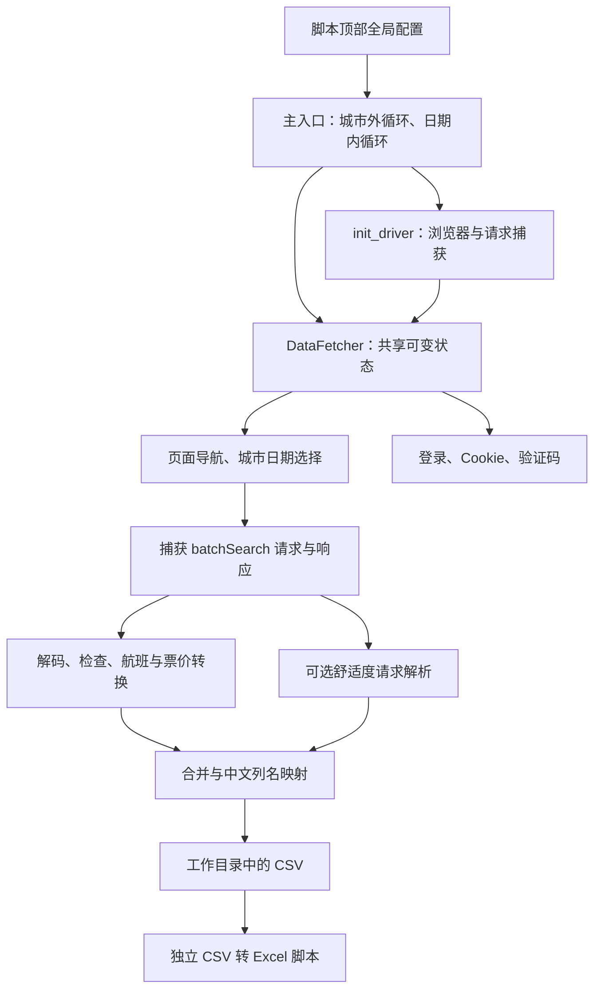
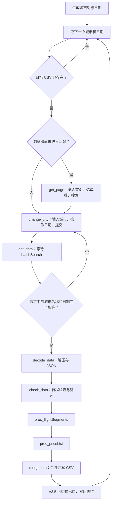
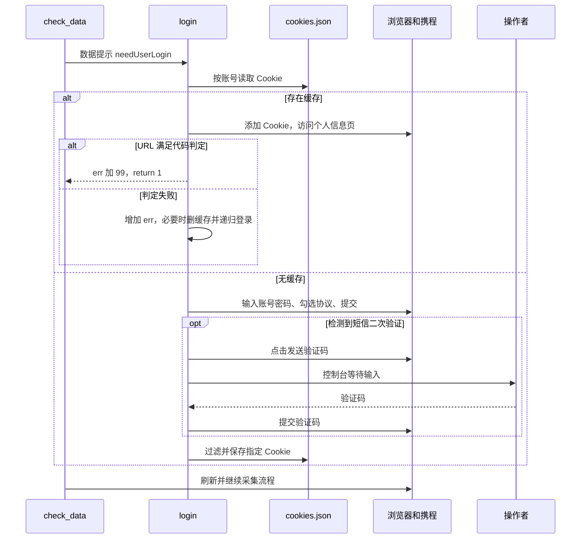
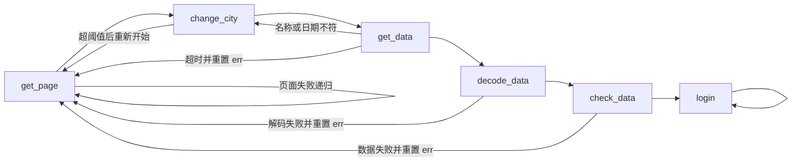
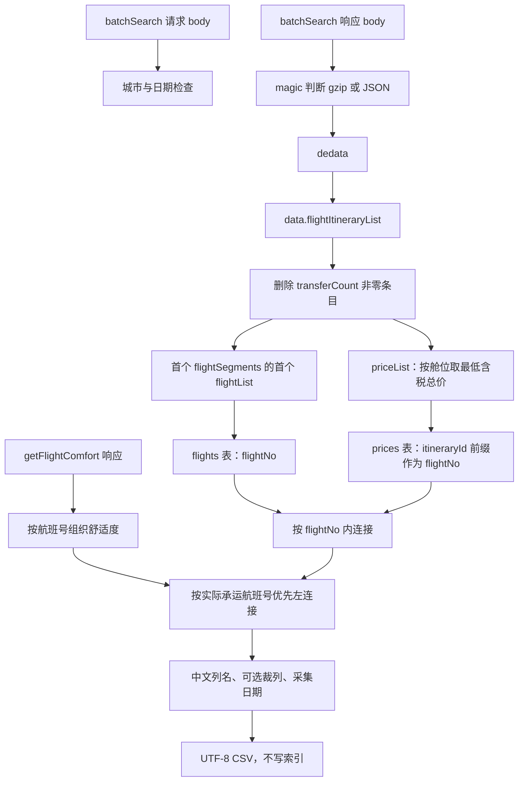
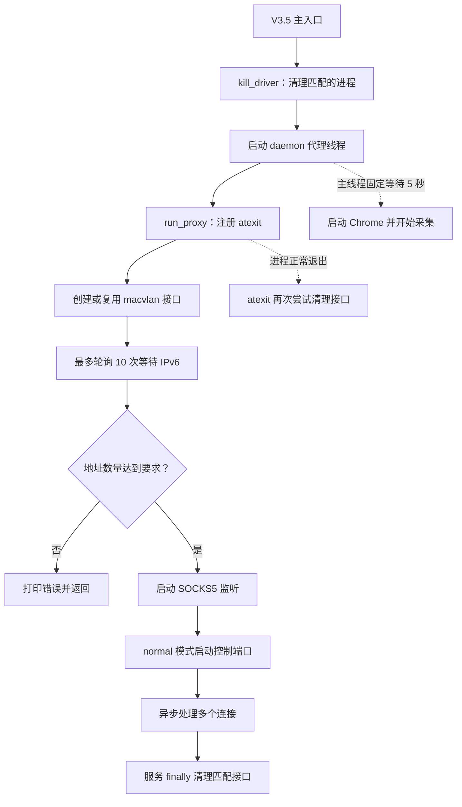
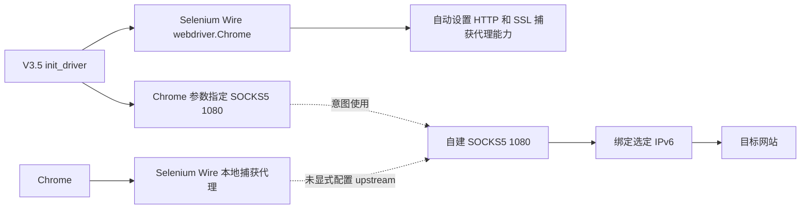

# V3 / V3.5：运行方式、逻辑与架构

> ID: CON-001 · Status: Archived
> Created: 2026-10-31 · Updated: 2026-11-01
> Purpose: 说明 V3、V3.5 与配套 IPv6 代理的运行方式、配置、控制流程和数据处理架构。

## 1. 文档范围

本文介绍 V3、Linux V3.5 及其配套 IPv6 代理。源码位于：

- [V3](../../../history_version/ctrip_flights_scraper_V3.py)：下文以 `V3::方法名` 指代。
- [V3.5](../../../history_version/Linux_version/ctrip_flights_scraper_V3.5.py)：下文以 `V3.5::方法名` 指代。
- [IPv6 代理](../../../history_version/Linux_version/gen_proxy_servers.py)：下文以 `Proxy::函数名` 指代。

V1、V2、历史票价脚本及 `history_version/` 根目录中的旧代理不在本文分析范围内。

本文以归档源码为依据，说明各模块的职责、调用关系和运行约束。

## 2. 功能概述

输入城市列表及出发日期，枚举有方向的城市对，在携程网站逐次搜索，获取每次搜索的航班、经济舱和商务舱报价，按出发日及采集日保存 CSV。可选采集航班舒适度信息，供后续分析。

采集流程由 **Selenium 操作网页、Selenium Wire 捕获网页请求、pandas 整理数据** 三部分组成。两个版本均使用单浏览器串行执行航线与日期任务。

默认三个城市产生六个方向的航线，默认 60 个出发日期，共 360 个候选任务；已有同路径 CSV 会跳过。实际网络请求远多于任务数，因为一次页面访问包含资源加载和多个接口请求。

## 3. 架构与职责



图中是逻辑职责，不是独立模块：除了 Linux 代理，几乎全部逻辑都写在同一个脚本和 `DataFetcher` 类内。

| 实现位置 | 职责 | 调用与状态关系 |
| --- | --- | --- |
| 顶部全局变量 | 目标、日期、超时、账号、输出选项 | 方法直接读取全局变量，没有独立配置对象 |
| `init_driver` | 浏览器选项、驱动启动 | 浏览器类型和部署平台写入代码 |
| `gen_citys` / `generate_flight_dates` | 任务集合生成 | 返回城市对和日期列表，由主入口遍历 |
| `DataFetcher` 页面方法 | DOM 操作与请求捕获 | 依赖具体 CSS 类名、元素顺序和页面刷新时机 |
| `DataFetcher` 数据方法 | 响应解析、字段转换与输出 | 依赖前序方法在实例上写入的中间状态 |
| `gen_proxy_servers` | Linux 接口、SOCKS5、出口选择 | 模块全局状态同时被代理线程和采集线程使用 |

`DataFetcher` 初始状态包括 `driver`、`date`、`city`、`err`、`switch_acc`、`comfort_data`。执行中再动态增加 `predata`、`dedata`、`flightItineraryList`、`flights`、`prices` 和 `df`。各方法通常直接调用下一阶段；它们并非接受显式输入、返回独立结果的流水线函数。

### 3.1 V3 与 V3.5 的差异

| 维度 | V3 | V3.5 |
| --- | --- | --- |
| 浏览器 | Edge，有界面，最大化 | Chrome，无头，1280×480，禁图片 |
| 默认 `crawl_interval` | 5 秒 | 1 秒 |
| 页面加载超时 | 未显式调用 `set_page_load_timeout` | `max_wait_time * max_retry_time`，默认 50 秒 |
| 启动前进程处理 | 无 | `kill_driver` 按进程命令中的 selenium / chromium / chromedriver 字样执行强制终止 |
| IPv6 代理 | 无 | 默认启用，守护线程内启动 |
| 页面验证码 | 等人工完成并回车；超时后重建浏览器、换账号索引 | 关闭浏览器，等 100 秒，重建，切换代理及账号索引 |
| 短信登录验证码 | 控制台人工输入，默认最多等 500 秒 | 同样人工输入，默认最多等 100 秒 |
| 首次页面判断 | URL 中不含 `http` | URL 恰为 `data:,` |
| 每个未跳过任务后 | 等待 | 切换 IPv6 索引，再等待 |
| 采集、解析和输出 | 串行执行 | 与 V3 基本相同，串行执行 |

V3.5 的线程用于代理服务和验证码输入。两个版本分别包含完整的采集实现，没有通过公共模块共享采集代码。

## 4. 运行方式与配置

### 4.1 依赖与启动目录

[V3 依赖文件](../../../history_version/requirements-v3.txt)声明 pandas 2.2.3、selenium-wire 5.1.0、blinker 1.7.0，以及按平台选择的 python-magic / python-magic-bin。[Linux 依赖文件](../../../history_version/Linux_version/requirements.txt)声明 pandas、selenium-wire 和 python-magic，但没有 V3 依赖文件中的 blinker 固定项。Selenium 通过依赖间接安装，版本没有在旧版直接固定。

运行 V3 需要 Edge；运行 V3.5 需要 Chrome。浏览器驱动应与浏览器版本匹配。Python 版本需满足依赖包要求，具体依赖以对应的 requirements 文件为准。

启动前，在脚本顶部设置城市、日期和登录参数。以下命令均在仓库根目录执行：

```powershell
# Windows / V3：先在归档脚本顶部设置目标与必要登录参数
python -m pip install -r history_version/requirements-v3.txt
python history_version/ctrip_flights_scraper_V3.py
```

```bash
# Linux / V3.5：需先核对网卡、权限、IPv6、Chrome 和依赖
python3 -m pip install -r history_version/Linux_version/requirements.txt
python3 history_version/Linux_version/ctrip_flights_scraper_V3.5.py
```

Linux 还依赖系统的 `ip`、`ping`，非 root 时涉及 `sudo`，以及能分配并路由 IPv6 的网络。创建 macvlan 不等于必然取得可用公网出口。`kill_driver` 的匹配范围不限于当前脚本启动的进程，运行前必须理解这一副作用。

V3.5 通过 `import gen_proxy_servers` 导入同目录代理模块。`history_version/Linux_version/` 下的两个 Python 文件需放在一起；根级 `history_version/gen_proxy_servers.py` 属于不同实现。

### 4.2 采集配置

| 参数 | 默认值 / 行为 | 实际语义 |
| --- | --- | --- |
| `crawl_citys` | 上海、香港、东京 | 使用显示名称；不以城市代码作为匹配身份 |
| `begin_date` / `end_date` | `None` / `None` | 显式起日优先；终日还会触发日期补齐 |
| `start_interval` | 1 | 未设起日时，从本机当前日期后一天开始 |
| `crawl_days` / `days_interval` | 60 / 1 | 先用 `range(0, n, days_interval)` 生成偏移，不始终等于最终日期数量 |
| `max_wait_time` / `max_retry_time` | 10 / 5 | 局部等待与重试阈值，不是整个任务的硬截止时间 |
| `direct_flight` | `True` | 实现无条件先删除转机条目；设为 False 并不能真正保留所有转机航班 |
| `comft_flight` | `False` | 开启后增加页面滚动与舒适度请求处理 |
| `del_info` / `rename_col` | `False` / `True` | 默认保留较多原字段并重命名部分列；组合开启裁列会影响票价、舒适度字段 |
| `enable_screenshot` | `False` | 异常时向相对 `screenshot/` 路径写入，代码未统一创建该目录 |
| `login_allowed` | `True` | 允许按需登录，不是主入口无条件先登录 |
| `accounts` / `passwords` | 各两个空字符串 | 需自行配置，按 `switch_acc` 分别取模索引 |
| `COOKIES_FILE` | `cookies.json` | 相对工作目录，以账号为键保存 Cookie 列表 |

日期函数会先按 `n` 生成序列；设置 `end_date` 后先过滤，再以 `flight_dates[-1]` 向终日补齐，因此终日可能使结果超过 `crawl_days` 的初始跨度。起日缺省且 `start_interval=0` 时起日未被赋值；空日期列表配合终日也可能越界。因此，显式结束日期需不早于起始日期，并确保生成的日期列表非空；未设置起始日期时，`start_interval` 需为非零值。

### 4.3 工作目录即数据目录

输出路径使用 `os.getcwd()`，不是脚本文件所在目录：

```text
<启动时工作目录>/
├── cookies.json
├── screenshot/                 # 启用错误截图时的目标位置
└── <航班出发日期>/
    └── <采集当天日期>/
        └── <出发城市>-<到达城市>.csv
```

Cookie、CSV 和截图的相对路径均基于启动时的工作目录。从不同目录启动脚本时，数据位置随之改变。日期使用操作系统时钟，源码没有单独的时区设置。

断点续跑仅以文件存在为依据，不检查文件是否为空、完整、列是否正确或上次是否成功。也没有任务状态库、失败清单或独立的“确实无航班”结果文件。

## 5. 单个任务的控制流



图示为常规调用路径，省略异常、登录和“无航班”分支。主循环不是一个严格状态机；失败会通过方法间的递归调用返回前序阶段。

`get_page` 首先打开国内机票首页，点击图标和单程选项，再点击搜索。随后 `change_city` 才修改为当前任务的目标。这意味着初始化搜索与目标搜索的网络请求可能同时存在。

`change_city` 按 `.form-input-v3` 元素的下标区分出发、到达城市，按输入框文本是否包含目标名称判断是否需要重填；日期选择依赖两个日历面板的年份、月份、日期及导航按钮。输入文本并不必然等于选中了对应城市候选项。

自定义 `element_to_be_clickable` 接收已经找到的 WebElement，再检查可见、可用；遇到旧元素失效时只是返回 False，不重新定位元素。显式等待因此不自动解决页面重绘后的元素失效问题。

`get_data` 等待匹配 `/international/search/api/search/batchSearch?.*` 的请求，从请求 body 的首个 `flightSegments` 检查城市和日期。它没有使用唯一任务 ID 关联请求；捕获缓存里残留的初始化或中间请求也会被选中。读取后会清除捕获列表，但将当前请求对象留在 `self.predata` 供解码使用。

## 6. 登录、验证码与恢复



登录由数据处理流程按需触发。`check_data` 在解析预期结构失败后，先检查 `searchErrorInfo`，再通过字符串查找 `needUserLogin`，决定是否调用 `login`。

仅保留 `name` 位于 `REQUIRED_COOKIES` 的 Cookie，每个保留项仍保存完整 Cookie 字典。它们按账号存储于同一个 JSON 文件，没有文件锁或单独的会话生命周期管理。缓存登录主要以个人信息页 URL 判断成功；`err += 99` 被用于影响后续恢复分支，错误计数同时承担流程控制职责。

短信验证线程通过 `join(timeout)` 等待；超时不会终止仍阻塞在 `input()` 的线程。二次验证处理发生异常时，代码输出“未检测到验证码验证页面”并继续执行后续 Cookie 保存逻辑；该分支没有进一步区分页面不存在与操作失败。

页面验证码和短信验证码是两条路径：V3 页面验证码等待人手操作，V3.5 页面验证码则重建浏览器和轮换出口；两版短信验证码都需要控制台输入。

### 6.1 错误计数与重试流程



`self.err` 在多处累加、清零，甚至增加 99；部分分支没有先检查总阈值，达到局部阈值后又重置并进入首页。因此 `max_retry_time=5` 不代表一个任务最多执行五次，也不能保证退出。主入口没有逐任务异常隔离与明确的成功、无结果、需认证、失败分类。

主循环结束后调用浏览器的 `quit()`；入口没有覆盖全部运行过程的顶层 `try/finally`。`mergedata` 成功和异常均返回 0，主循环不检查其返回值，完成提示在循环结束后统一输出。

## 7. 数据模型、转换与输出



### 7.1 响应解码与行程选择

`decode_data` 用 `magic.Magic().from_buffer` 判断响应类型。gzip 分支解压并赋值 `self.dedata`，随后 `json.loads`；普通 JSON 分支只打印文本，没有更新 `self.dedata`，可能访问未初始化或前次残留状态。它不是完整的 HTTP Content-Encoding 解码实现。

`check_data` 从 `data.flightItineraryList` 取列表并原地删除首段 `transferCount != 0` 的条目。删除不受 `direct_flight` 开关控制；该开关仅参与空列表后的早退条件。后续仅解析首个航段中的首个航班，不是通用多段行程模型。

### 7.2 航班与票价

`proc_flightSegments` 拆分起降日期时间，保留航司、机场、机型等字段；把 `stopList` 拼成中文经停描述，空值写“无中转”。这里的经停描述和前面按 `transferCount` 判断的换乘不是同一概念。

`proc_priceList` 只处理舱位 `Y`、`C`：每舱将成人价和税费相加，选择总价最低的那条，再从同一条取基础价、税费及 `miseryIndex`。缺少 `adultTax` 时用 `sortPrice - adultPrice` 估计，`freeOilFeeAndTax` 为真时估计为零。缺少 `sortPrice` 则使用成人价。这些规则用于构造输出中的基础价、税费和总价字段。

| 输出字段族 | 保存内容 |
| --- | --- |
| `economy_origin / tax / total` | 经济舱最低总价对应的基础价、税费、总价 |
| `bussiness_origin / tax / total` | 商务舱同类字段，保留历史拼写 `bussiness` |
| `economy_full / bussiness_full` | 实际保存 `miseryIndex`；不能仅凭命名解释为全价或折扣 |
| 缺少对应舱位 | 用空字符串表示，不是统一数值空值 |

航班表与价格表通过 `flightNo` 默认内连接，价格表航班号取 `itineraryId.split('_')[0]`。代码没有验证两边唯一性；连接键值没有匹配时航班会被丢弃，缺少 `flightNo` 列则会在合并时报错，重复键可能扩张结果。该连接以航班号为键，不包含日期、机场或行程标识。

### 7.3 舒适度与列裁剪

开启 `comft_flight` 后滚动页面，扫描捕获请求：`batchGetComfortTagList` 只用于检测和计数，详细数据从 `getFlightComfort` 响应读取。提取延误、廊桥、机型机龄，以及经济舱 / 商务舱的餐食、座椅和电源等信息；按请求中的首个航班号组织字典。

合并时优先使用 `operateFlightNo`，为空时使用 `flightNo`，左连接舒适度。未采集到舒适度时补空列。`del_info=True` 会在较早阶段删去 `operateFlightNo`，因而改变此匹配策略。

当 `rename_col=True` 且 `del_info=True`，输出列序先从基础映射取出，再补入舒适度映射，最后按先前基础列序裁剪，因此票价及舒适度列可能被排除。`columns.update(comfort_columns, errors='ignore')` 是字典更新，会额外加入名为 `errors` 的映射，并不是 pandas 的忽略错误选项。

V3 时期的 CSV 转 Excel 脚本是独立后处理工具，按固定列名筛选数据，不被爬虫调用。根目录的当前转换工具已改为保留输入列的并集，使用方式见 [使用指南](../../guides/GUI-002-usage.md#转换为-excel)。

## 8. Linux IPv6 代理架构

### 8.1 接口与服务生命周期



主线程等五秒不是就绪握手。代理自身等待 IPv6 最多约十轮，创建接口和 ping 检查还需要时间；后台线程退出或启动失败不会自动成为主线程的任务失败。

`get_existing_interfaces` 用 `ip addr` 文本和接口命名规则匹配 `<base>_<数字>@...`，每个接口取第一个非 `fe80` IPv6 地址。它没有完整验证地址作用域、生命周期、DAD 状态和目标可达性。`create_ipv6_addresses` 可复用通过 ping 检查的已有接口，或删除后重建；部分 subprocess 调用未检查返回码。

### 8.2 SOCKS5 与出口选择

代理接受无认证 SOCKS5 CONNECT，解析 IPv4、域名或 IPv6 目标地址；实际出站 socket 始终为 `AF_INET6`，先 `bind` 本地选定 IPv6，再连接目标。因此解析支持三类地址，不等于已实现三类目标的通用连通性；IPv4 字面量和无 IPv6 的域名没有独立 IPv4 路径。

成功后两个异步 `pipe` 转发双向字节流。这是 TCP 代理，不解析携程业务，也不提供 UDP ASSOCIATE 或 HTTP 采集逻辑。

- `random`：每个新连接随机选择地址，没有控制监听。
- `normal`：每个新连接读取全局索引；`switch_proxy_server()` 将索引递增取余。
- 控制端口接收 `switch <index>`，直接指定索引，默认绑定 `127.0.0.1:1081`。
- 切换只影响之后新建的 TCP 连接，不会迁移既有连接或浏览器连接池。
- 地址集合未就绪时调用 `switch_proxy_server()` 可能取余零；不存在可靠就绪事件或统一关闭协议。

V3.5 默认 `ip_mode='normal'`、`ipv6_count=120`、`base_interface='eth0'`，SOCKS5 监听 `0.0.0.0:1080`。该监听地址接受所有网络接口上的连接，代理不提供身份认证。

除由 V3.5 启动外，代理也可独立运行：

```bash
python3 history_version/Linux_version/gen_proxy_servers.py \
  --mode normal --port 1080 --bind-address 127.0.0.1 \
  --base-interface eth0 --num-interfaces 3
```

示例限定本机监听，与 V3.5 内置启动的监听地址不同；执行时仍会管理 Linux 接口。在 Python 中调用 `switch_proxy_server()` 可切换 normal 模式使用的地址索引。

### 8.3 浏览器捕获代理与 SOCKS5 配置



V3.5 在 Chrome 参数中添加 `--proxy-server=socks5://127.0.0.1:1080`。Selenium Wire 5.1.0 的 `webdriver.Chrome.__init__` / `DriverCommonMixin._setup_backend` 同时默认创建本地捕获代理，并设置 `httpProxy`、`sslProxy`。脚本没有通过 `seleniumwire_options` 为捕获代理配置 SOCKS5 上游。图中实线表示组件关系，虚线表示 Chrome 的代理参数及捕获代理与 SOCKS5 之间未显式配置的上游关系，不表示已经建立了串联转发链路。

### 8.4 清理语义

V3.5 将 `delete_interface` 作为 `delete_iface` 传入接口创建过程，控制**启动前是否删除匹配接口**。即使它为 False，服务 `finally` 与 `atexit` 仍会调用清理。

清理按命名规则查找接口，没有维护“本进程创建的接口”清单，可能删除复用的匹配接口；又因接口查找只返回已有非链路本地 IPv6 的接口，未取得地址的接口可能不在清理集合中。启动失败、强制终止或守护线程结束也不能保证所有清理回调完成。
