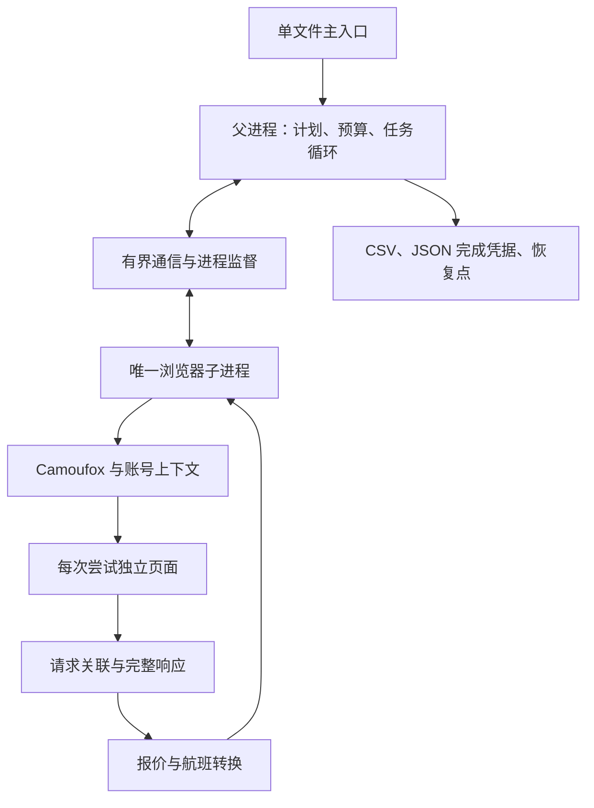
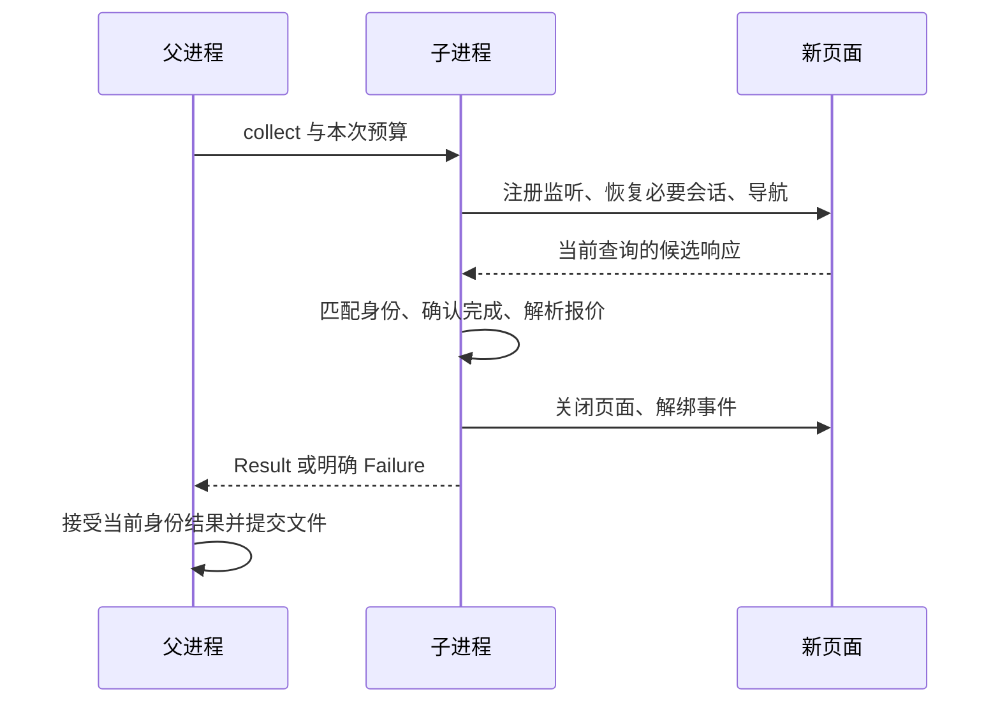
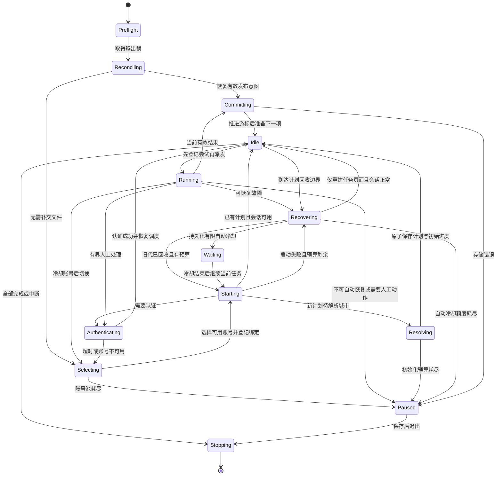
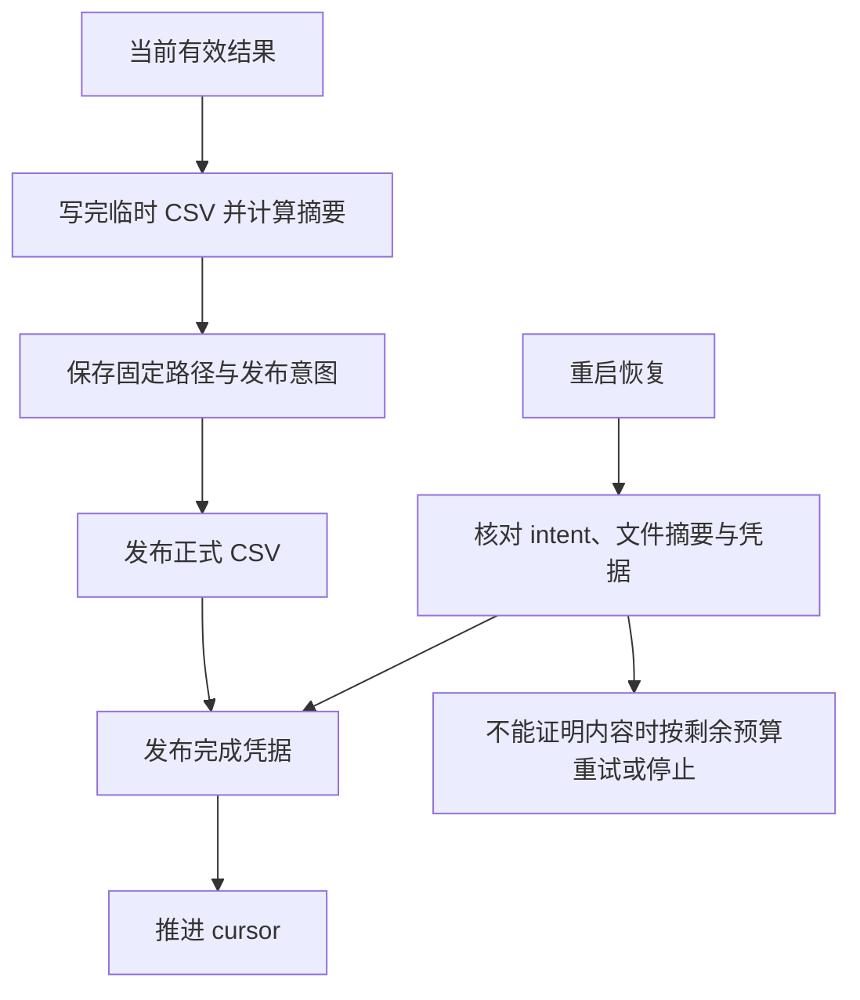

# V4 架构与运行合同：Camoufox、独立单文件与长任务恢复

> ID: CON-002 · Status: Current
> Created: 2026-11-01 · Updated: 2026-11-05
> Purpose: 说明 V4 的单文件架构、父子进程协议、账号池、采集与文件恢复规则，以及可复现的验证标准。

## 1. 架构概览

V4 是在既有业务基础上的架构升级，保持航线与日期批量采集、浏览器会话复用、经济舱与商务舱报价、可选舒适度以及 CSV 交付。历史实现说明见 [CON-001](../archive/legacy-reference/CON-001-v3-v35-architecture.md)。

核心架构如下：

1. **唯一浏览器为 Camoufox。** 使用其 Firefox 内核与 Python 异步接口，不同时维护 Chromium、Patchright、Selenium 或其他备用引擎。
2. **运行入口是根目录的单个 `ctrip_flights_scraper.py`。** 使用者可只下载这个文件；安装声明的第三方依赖和浏览器后即可运行。不要求下载仓库、辅助 Python 文件、模板或构建工具。
3. **一父一子的串行采集。** 父进程负责调度、预算、持久化和监督；一个长期子进程持有浏览器并串行采集，不引入并发任务池。
4. **不使用应用数据库。** 业务结果存 CSV，任务计划、当前恢复点与完成凭据存普通 JSON；不引入 ORM、数据库服务或自制追加事务日志。
5. **保留原业务价值，替换不可靠的控制机制。** 登录缓存、请求身份核对、按采集日组织输出等继续保留；递归恢复、全局错误计数和只凭文件存在判断成功被替换。

本文描述当前实现的架构和运行边界。验证章节定义可复现的检查方法与长期稳定性标准，文档状态不表示这些检查已在任意环境通过，也不构成持续访问站点的保证。

## 2. 范围与不变量

### 2.1 业务范围

- 输入城市列表，生成有方向的城市对；按配置日期范围查询单程航班。
- 保留经济舱、商务舱报价及其组成字段；候选完整时选择最低含税报价，字段缺失时明确价格状态和比较口径。保留代码共享和实际承运航班关系。
- 保留可选舒适度数据，补充数据失败与核心报价失败分开处理。
- 支持账号池，每个账号独立保存会话；验证码短期无法解决时冷却当前账号，选择下一可用账号继续当前任务。
- 图形验证码与短信认证保留人工处理方式，账号池耗尽时明确暂停，不无限轮换。
- 支持直连和一个外部 HTTP / SOCKS5 代理配置。
- 支持中断恢复、明确无航班结果和有限自动恢复。

不增加分布式服务、Web 控制台、定时任务平台、并行浏览器池、验证码破解或运行时多引擎切换。Linux 网卡生成、IPv6 轮换与防火墙管理留在独立部署边界；旧代理保留归档，不进入单文件采集程序。

### 2.2 必须始终成立的不变量

| 编号 | 不变量 | 实现约束 |
| --- | --- | --- |
| I1 | 一个任务只能有一个在途尝试 | 父进程收到终态或完成回收后才派发下一项 |
| I2 | 只有父进程能提交业务结果 | 子进程不写正式 CSV、完成凭据或 progress |
| I3 | 恢复不清零消耗；额度扩展按有限策略留痕 | 派发与冷却先持久化，自动轮数和人工追加分别记录，重启不补额度 |
| I4 | 错误响应不能变成成功或无航班 | 先校验任务身份、业务状态和响应完整性 |
| I5 | 只认当前 worker 代次与 attempt | 迟到消息拒绝提交 |
| I6 | 完成凭据必须指向确定的 CSV 内容 | 包含任务身份、路径、字节摘要、行数和 schema |
| I7 | 相对日期只展开一次 | 恢复读取固定计划，不按恢复当天重算 |
| I8 | 未证明归属的文件和进程不处理 | 不覆盖旧 CSV，不按名称全局结束浏览器 |
| I9 | 独立成品无仓库运行依赖 | spawn、默认配置、字段映射和恢复代码全部在单文件内 |
| I10 | 暂停与失败不能显示为完成 | 终态、退出码和汇总对应真实提交结果 |
| I11 | 账号切换不改变任务，也不清零已耗预算 | 同一 task 保留次数与耗时，账号会话与 worker 代次隔离 |
| I12 | 账号池只有一个状态写入者 | 父进程更新账号状态，子进程仅报告认证事实 |

## 3. 与历史版本的设计关系

| 原设计 | 保留的目的 | V4 的具体实现 |
| --- | --- | --- |
| 浏览器正常操作后捕获接口 | 利用站点会话和正常请求构造，不单独维护签名 | Camoufox 原生响应监听 |
| 首页初始化与后续查询分开 | 必要前置状态只建立一次 | 在认证上下文中完成必要初始化，任务页面只执行目标查询 |
| 浏览器复用 | 减少启动和登录成本 | 跨任务保留上下文，每次尝试新建页面 |
| 城市与日期二次检查 | 防止写错航线和日期 | 代码身份与请求条件共同匹配，名称用于展示 |
| 分阶段处理方法 | 便于理解采集流程 | 保留导航、获取、解码、检查、转换、合并语义，阶段不自行重试 |
| Cookie 缓存 | 减少重复认证 | 认证状态与固定指纹描述共同保存，不复制旧 Cookie 名称白名单 |
| 多账号配置 | 验证码暂时无法完成时切换账号，维持任务连续性 | 明确的账号池、独立会话、冷却和有界切换；一般网络错误不切账号 |
| 报价选择及承运航班匹配 | 报价一致性与代码共享语义 | 完整报价比较含税总价；不完整报价保留票面价并明确口径，修正行身份键 |
| 按出发日、采集日、航线写 CSV | 人工可读与票价历史比较 | 保留布局，增加独立完成凭据 |
| 跳过已有文件 | 简单断点恢复 | 通过当前批次凭据及摘要确认，不仅检查存在 |
| 独立代理模块 | 网络出口与采集解耦 | 浏览器直接使用外部代理，程序不管理网卡 |

正式查询使用站点正常的单程搜索链接，由页面构造并发出业务请求。城市解析和认证各自处理必要的前置页面操作；任务失败按同一查询路径和预算恢复，不临时切换另一套采集流程。

## 4. 独立单文件的开发与分发合同

### 4.1 用户拿到的是什么

`ctrip_flights_scraper.py` 包含默认配置、模型、监督器、浏览器会话、站点适配、数据转换、文件恢复、命令解析和主入口。内部逻辑按可读章节组织，不使用编码字符串隐藏代码。

用户需要 Python、声明的第三方 Python 包，以及 Camoufox 浏览器二进制和它所需的系统库。这些是第三方运行环境，不是仓库源码依赖。浏览器下载、Linux 系统依赖安装与正式采集分开；脚本不在执行任务时自行安装或升级软件。

以下内容不能成为运行前提：`crawler/`、维护片段、仓库中的 requirements 文件、模板、额外城市映射文件、项目安装命令、PYTHONPATH 注入或从网络下载项目源码。

### 4.2 唯一源码与确定性生成

维护时采用少量普通 Python 源码片段，按显式顺序拼成可读单文件：

```text
source_sections/
├── imports.py.inc          # 标准库顶层导入、版本与延迟依赖加载函数
├── config.py.inc           # 顶部用户配置、模型和参数校验
├── files.py.inc            # 计划、恢复点、CSV 与提交凭据
├── processing.py.inc       # 纯数据转换与列定义
├── browser.py.inc          # Camoufox、认证、页面与站点协议
├── worker.py.inc           # 子进程入口、监督和有界通信
└── main.py.inc             # 主循环、命令行及唯一 main guard
scripts/build_single_file.py
ctrip_flights_scraper.py # 提交到仓库的完整分发产物
```

片段是构建输入，不是另一套可独立运行的模块包。构建器只按固定清单拼接文本并加入节标题，不设计通用打包框架，不引入 import hook、exec、base64、动态模块注册或运行时解包。

生成规则：

- 唯一权威源码是片段；仓库维护修改片段后重新生成根文件。
- 生成结果固定 UTF-8、LF、片段顺序，不加入构建时间或机器路径，保证相同输入产生相同字节。
- 顶层业务名称不能重复，成品只有一个 main guard；标准库可在片段中显式导入，第三方包在需要时延迟导入，确保未安装第三方包仍可显示 help。所有运行资源为单文件内常量或运行时创建的数据。
- `imports.py.inc` 在合法文件起始位置启用 postponed annotations，类型注解不会迫使第三方包提前加载。
- `RUNTIME_REQUIREMENTS` 保存精确依赖版本，help 从该声明生成安装命令；脚本头部安装说明和 requirements 与其保持一致。
- 构建检查包含 compile、重复符号、仓库相对导入检查、main guard 检查及重建后的逐字节一致性。
- 使用者下载后可编辑成品顶部配置；程序运行不反向生成、不覆盖用户修改。提交项目变更时仍修改权威片段，避免两套维护来源。

### 4.3 spawn 从单文件启动

`worker_main`、通信模型与异常类均为成品顶层定义，父进程显式使用 spawn。main guard 内调用 `multiprocessing.freeze_support()` 和主函数；导入成品时不创建锁、不解析参数、不初始化日志、不启动浏览器或下载文件。

父进程校验并规范化配置后显式传给子进程。子进程不能重新读取默认值来猜测运行参数，也不能依赖父进程修改过的模块全局变量。不能跨进程传递浏览器对象、事件循环、闭包、打开的文件或局部函数。

Python 的 spawn 与入口保护约束参考 [multiprocessing 文档](https://docs.python.org/3.12/library/multiprocessing.html)。

## 5. 运行界面与安装

### 5.1 使用方式

默认命令仍是：

```bash
python ctrip_flights_scraper.py
```

同一文件提供少量参数：

```text
--help                         显示内嵌说明，不要求启动浏览器
--check-environment            检查包、浏览器构建和指纹模型，不访问携程
--output <directory>           覆盖默认数据目录
--resume <run_id>              恢复固定批次，不重算日期
--run-id <run_id>              幂等创建或恢复固定批次，完成后返回 0
--retry-current <TASK:ATTEMPT>  为已耗尽的当前任务显式追加有限额度，须配合 resume
--refresh-proxy-credentials     显式迁移旧批次代理认证绑定，须配合 resume
--recovery-reason <TEXT>        人工恢复原因，非空且不超过 256 字符
--login <account_alias>        有界面认证并保存对应会话
--headless / --headed          覆盖显示模式
--cities <city> [<city> ...]    覆盖新批次城市列表
--begin-date <YYYY-MM-DD>       覆盖新批次起始日期
--days <count>                 覆盖新批次采集天数
--anonymous                    明确使用匿名模式
--version                      显示程序版本
```

`--login`、`--resume`、`--run-id` 与环境检查互斥；不指定这些参数时创建新批次。`--run-id` 首次使用时创建该编号的初始化记录，后续使用同一编号和 output 时读取已有初始化或固定计划，完成后不再创建新批次。它适用于由外部进程管理器反复启动同一命令的场景。人工追加或代理旧绑定迁移仍须显式使用 `--resume`。

参数解析与 help 在第三方模块加载前完成，缺包时仍能看到安装说明；正式运行缺包或缺浏览器则立即报出具体依赖，不表现为子进程无响应。独立登录固定使用有界面模式和人工验证等待，不受默认 headless 设置影响。

脚本头部内嵌完整安装说明，无需另行下载 requirements。当前固定运行组合及浏览器、指纹模型准备命令如下；运行时不跟随活动浏览器版本或自动下载缺失资源。[Camoufox 安装说明](https://camoufox.com/python/installation/)。

```bash
python -m pip install camoufox==0.5.8 playwright==1.60.0 fpgen==1.3.0 filelock==4.2.6 psutil==7.2.2 tzdata==2026.6
python -m camoufox fetch official/152.0.4-beta.29
python -c "from camoufox.fpgen_model import ensure_fpgen_model; ensure_fpgen_model()"
```

Python 基线为 3.12。包与浏览器版本由内嵌依赖声明固定，环境检查核对版本、指定浏览器构建及指纹模型是否已准备；这不替代下文要求的两平台业务、故障和完整长跑验收。

### 5.2 依赖与职责

| 依赖 | 用途 |
| --- | --- |
| Camoufox 0.5.8 / Playwright 1.60.0 | 唯一浏览器与原生网络事件 |
| fpgen 1.3.0 及 Camoufox 固定指纹模型 | 浏览器身份生成所需运行资源 |
| filelock 4.2.6 | output 的跨平台排他锁 |
| psutil 7.2.2 | 自有进程身份、子进程树与资源用量 |
| tzdata 2026.6 | 提供固定时区数据，特别是缺少系统数据的环境 |
| 标准库 asyncio、multiprocessing、csv、json、decimal 等 | 控制流、文件和数据处理 |

数据转换使用普通列表、字典与 Decimal，不再循环 concat；宽表形式保留，价格选择与缺失语义见 §9.2。运行依赖不包含 Selenium Wire、python-magic 或应用数据库。

### 5.3 默认配置与参数优先级

新运行的优先级为：命令行明确覆盖项 > 脚本顶部默认配置。恢复先加载 run.json 或尚未完成的 initialization.json 中的冻结配置，再应用明确指定的显示模式与输出位置；凭据从本地配置读取。城市、日期、筛选模式和字段合同改变必须新建批次，恢复不要求重复指定匿名模式。

| 配置组 | 内容与规则 |
| --- | --- |
| 城市 | 保留中文城市列表；去除完全重复输入，保留首次顺序，解析后相同城市身份不得互为航线 |
| 日期 | 保留 begin_date、end_date、start_interval、crawl_days、days_interval，明确生成规则见下文 |
| 数据 | direct_flight、comft_flight、comfort_timeout、rename_col 写入计划；固定字段集合由 CSV_COLUMNS 声明 |
| 认证 | 一个 accounts 对象列表，含别名、登录标识、凭据来源和 enabled；不再分别维护可能错位的账号/密码数组 |
| 网络 | 一个外部代理配置；凭据不进入日志与公开摘要 |
| 运行 | 输出路径、时区、显示模式、访问间隔、auto_recovery_rounds / auto_recovery_cooldown 和有限的资源参数 |

无 end_date：从 begin_date 或创建批次当天加 start_interval 开始，生成偏移 `range(0, crawl_days, days_interval)`；有 end_date：从确定起日按 days_interval 生成不超过终日的日期，终日优先于 crawl_days。该规则保留旧函数在有效输入上的结果，并消除先生成再补齐的空列表边界。start_interval=0 明确表示今天；负跨度、非正间隔、终日早于起日和空任务集启动前拒绝。

账号别名在 output 内唯一且稳定；相同登录标识不得重复配置为多个别名。run.json 记录账号别名顺序和非敏感配置摘要，不含密码；accounts.json 在私有运行目录记录登录标识摘要，用于检测同一别名被改绑另一账号。恢复时账号池成员与业务计划保持一致，允许更新凭据或完成认证，不静默增加、删除或重排账号池。

默认输出目录相对于单文件所在目录；显式相对 `--output` 相对于命令工作目录解析。父进程解析为绝对路径，并在启动日志显示最终位置。

### 5.4 代理身份与凭据更新

新计划使用 `proxy_identity_version=2`：`proxy_id` 是代理对象去掉独立 `username`、`password` 字段后其余连接设置的稳定摘要。代理端点、协议、bypass 等非认证设置被冻结；仅更新这两个认证字段后，可直接恢复原批次。直连与使用代理也是不同的连接配置，不能在 resume 时静默互换。该绑定约束配置，不保证代理服务实际分配的公网 IP 保持不变。

没有版本字段或版本为 1 的旧计划使用包含认证字段的整体摘要。其认证凭据变化时，只有显式执行 `--resume <run_id> --refresh-proxy-credentials --recovery-reason <TEXT>` 才能迁移。旧摘要不可逆，程序不能从中还原原端点；执行者必须确认端点、协议、bypass 等非认证设置确实没有变化，不能用此选项更换出口。

迁移在当前初始化记录或 progress 中写 `proxy_binding_override`，记录原摘要 `legacy_proxy_id`、新的连接摘要、版本、时间和原因，保留原 run.json 及其摘要。绑定建立后继续严格比较新的连接摘要，不能再次通过该选项改绑端点。已有版本 2 的批次无需迁移即可更新独立认证字段；此选项也不能为旧直连批次添加代理或移除已有代理。

### 5.5 退出与完成合同

| 退出码 | 含义 |
| --- | --- |
| 0 | cursor 到达固定计划末尾，当前没有待发布内容；全部已处理任务为核心成功或明确 empty |
| 1 | 已分类的可重试故障未能在当前运行流程中继续 |
| 2 | 参数、账号配置、Python 包或浏览器运行环境检查不通过 |
| 3 | 有限恢复额度耗尽，或需要人工动作的暂停，包括代理故障、账号池耗尽、认证、限流、协议变化或日期过期 |
| 4 | 存储、进程回收、IPC、未知普通程序错误或未分类错误 |
| 130 | SIGINT / Ctrl+C 中断，已尽力保存恢复现场并关闭自有资源 |
| 143 | SIGTERM 停止，已尽力保存恢复现场并关闭自有资源 |

有效响应中价格字段缺失、可选舒适度缺失不改变“核心成功”的定义：已取得的行程与报价可按明确状态提交。结束汇总分别展示价格不完整任务数 `price_partial`、舒适度 `comfort_partial` / `comfort_unavailable`，不能称所有字段完整；每个任务完成日志也展示 `price_status`。恢复发现 cursor 已到末尾且没有待提交内容，直接输出已完成，不启动浏览器。已完成文件后来被外部修改不由 cursor 自动检测，需要额外核对原文件与 meta 摘要；不能把恢复点当作外部文件永远存在的保证。

## 6. 内部职责与数据对象



内部数据按以下职责组织，使用字典及少量控制对象表示：

| 对象 | 必需内容 |
| --- | --- |
| RunPlan | schema、run_id、规范配置、创建时间、固定日期、城市身份与遍历顺序、计划摘要 |
| Task | task_index、task_key、出发到达身份、日期、查询选项 |
| Attempt | attempt_id、worker_generation、已用次数、预算、起始时间 |
| Observation | observed_at、规范化行与列、结果状态、价格状态和原因、舒适度状态和原因 |
| Failure | 当前操作身份、错误码、脱敏 diagnostic 及可选 retry_after |
| Progress | cursor、当前 Attempt、批次状态、冷却截止时间、累计统计、发布意图、blocked_accounts、auth_used_aliases、当前认证预算、账号绑定序号及自动 / 人工恢复记录 |
| AccountPool | output 内各账号的状态、冷却截止时间、会话引用、状态变更序号和选择顺序 |
| Receipt | 任务与批次、result_id、实际路径、摘要、schema、行数、观察时间和状态 |

TaskKey 根据规范化城市代码、出发日与结果相关选项产生稳定摘要，不能使用 Python 内建 hash。run_id 区分不同采集批次：同一航线日期在新批次再次查询是新的价格观察。

未知字段不一律拒绝；输入配置、IPC 消息、站点核心合同和文件恢复边界集中校验。避免每个内部函数重复执行相同校验。

### 6.1 正式任务之前的初始化

`operation_id` 标识初始化、启动、城市解析或认证操作；只有正式计划已存在时才携带 run_id，不能为独立登录伪造采集批次。

新运行顺序：

1. 完成不依赖网络的参数校验，取得 output 锁，冻结本次相对日期展开结果。
2. 在 `.runs/<run_id>/initialization.json` 原子保存排除凭据后的配置摘要、固定日期、初始化 operation_id 与已用预算；此时没有正式任务，也没有 run.json。run_id 已被预留用于目录与恢复命令，但初始化消息中的批次关联为空，直到计划正式发布。
3. 加载账号池状态并选择一个候选身份，执行有界会话准备与浏览器启动。
4. 发出 resolve，读取正常站点城市数据，返回确认的城市代码；解析名称歧义、代码重复和安全文件名。需要认证时沿用同一账号池规则。
5. 父进程校验返回结果并计算最终计划摘要，先在初始化记录保存发布状态和摘要，再原子发布包含完整规范计划的 run.json，随后创建 cursor=0 的 progress；初始化记录不存第二份完整计划。若 run.json 已发布而首份 progress 尚未发布，可按下述标记补建初始 progress。
6. 正式计划与 progress 就绪后才派发 collect。initialization.json 留作该次初始化的有限记录，不当作任务历史日志。

城市解析调用累计预算为 180 秒、最多 3 次尝试，独立于尚未存在的任务预算；认证调用另按认证预算处理，尚无正式任务时的浏览器启动也有独立预算，见 §11.2。这些预算不表示初始化全过程的墙钟上限。初始化中断用 `--resume <run_id>` 继续冻结后的初始化，不重新计算日期。run.json 已存在时，resume 直接使用已确认代码；站点后来不接受它们应报协议错误，不能悄悄重新解析改变任务。

实际发布标记是 `phase=plan_complete`、`resolved_plan_hash` 和 `progress_initialized`。发布 run.json 前先保存前两项及 `progress_initialized=False`，首份 progress 成功写入后改为 True；确认前禁止派发任务。恢复校验 run.json 自身的内容摘要；补建缺失的首份 progress 时，另校验初始化记录中的 phase、计划摘要及 False 标记，三者均满足才可补建。True 已确认后 progress 丢失属于损坏，不能重新从零开始。首份 progress 及其补建路径都继承初始化的 `rate_limit_recoveries` 和 `server_not_before`，不重新赠送限流恢复额度。尚无 run.json 时仍按已冻结的初始化输入和剩余预算处理，不能仅凭摘要猜测城市代码。

初始化过程使用 initialization.json 保存选择账号、阻塞集合、认证计数和账号状态变更确认；正式任务使用 progress.json，独立 login 使用 auth_control.json。下文所称“操作控制记录”指这三者中当前适用的一份，规则相同但不伪造 task 或批次。

取得 output 锁后，任何命令都先确认 accounts.json 中未完成的状态变更，再创建或覆盖新的操作控制记录，特别是再次执行独立 login 时不能先覆盖旧 auth_control.json。初始化的三次操作上限指 resolve 的执行尝试，不是账号选择次数；切换账号不重新分配初始化的城市解析预算或认证预算。

独立 `--login` 只创建认证操作，在账号目录保存当前有限认证控制记录；没有采集计划，不创建假 run.json，也不推进任何任务。Ready 只说明浏览器启动完成，不代表城市已解析或登录已通过。

## 7. Camoufox 会话与指纹

### 7.1 唯一启动方式

子进程使用 AsyncCamoufox。明确指定已经安装的精确浏览器构建，禁止跟随运行机器的活动版本无声漂移。官方 Python 接口支持异步使用、指定构建、显式指纹 preset 字典和持久上下文。[Camoufox 用法](https://camoufox.com/python/usage/)。

采用可关闭重建的非持久 BrowserContext，持久化的是显式认证快照和指纹描述，而不是把任务状态塞进浏览器用户目录。浏览器内部缓存实现不属于应用数据存储设计。

`BrowserSession.start()` 在 `browser.new_context()` 上设置 `ignore_https_errors=True`。项目的登录、城市解析和采集页面均使用该上下文，HTTPS 证书错误不会阻止页面访问；该策略适用于整个上下文，不是单个站点或指定 CA 的白名单。仅放宽项目上下文的证书校验，不更改系统信任库，不使用 Chromium 启动参数，也不影响其他上下文的校验策略。会话恢复仍通过原有 storage_state 参数完成，浏览器重建时重新应用同一上下文策略。

### 7.2 每个账号一个确定的会话身份

父进程管理 `sessions/<alias>/session.json`，单个原子 JSON 包含版本信息、已解析的指纹描述、认证 storage state 和必要的站点会话数据。别名只允许安全字符，不在路径中直接使用账号或手机号。

首次建立身份时，子进程在启动操作内从锁定版本支持的 preset 来源选出一个具体字典，以 profile 返回父进程；父进程原子保存初始身份后回复 profile_accepted，子进程收到确认后才启动浏览器或加载认证。初始无认证身份允许空 storage state，但不能用它覆盖已有有效快照。后续不会因重启再次选取指纹；后续启动传这个字典，不传每次随机选取的 `True`，不每任务重新随机生成。记录采用的浏览器构建、操作系统配置与指纹描述摘要。

身份记录同时保存具体 preset 和 Camoufox 生成的已解析 launch 配置，记录平台与精确构建。重启从该配置创建浏览器，仅应用明确允许变化的显示模式、环境及代理设置；不再次随机生成身份。身份中不保存完整宿主环境变量；指纹模型与身份生成仍使用所固定的运行组合。

跨系统复制会话不承诺仍保持同一环境。恢复发现浏览器构建、会话 schema 或系统不兼容时明确停止，需要使用独立输出目录建立身份并重新认证，不静默重新生成身份后继续沿用旧 Cookie。

### 7.3 认证状态保存与刷新

- 导航前加载最近一次有效快照；只保存选定账号的状态。
- 成功认证和正常任务边界读取最新状态，父进程原子更新 session.json，避免只保存最初 Cookie 后会话逐渐过期。
- 认证材料通过独立 `session` 消息传输，禁止写日志；达到大小上限报明确错误。消息关联当前账号绑定、operation_id 及已有的 attempt_id 或 auth_id，携带 identity、state 和当前 worker 内递增的 `snapshot_sequence`。
- 状态保存失败时停止派发并报告，会话更新不应默默丢失。
- 不把“URL 没变化”单独当作登录成功；检查明确的账号状态及业务请求权限。

成功操作先发送 `session`，再发送引用同一 `snapshot_sequence` 的 `result`。父进程要求序号连续，先校验身份并原子保存快照，保存成功后才更新已接受序号；结果引用不一致则拒绝。`snapshot_sequence` 只在当前 worker 内计数，不能当成跨重启版本。持久文件中的 `session_identity_id` 与 `session_revision` 由父进程拥有：身份不变，接受快照时 revision 递增并记录 updated_at。账号池的 ready 与显式登录成功证据仍由认证控制流程决定，收到状态快照本身不等于登录成功。

尚未完成短信或图形验证时，子进程可以发送 `auth_checkpoint`。父进程将其另存为 `auth-candidate.json`，包含账号、session_identity_id、候选 state、saved_at、challenge_visible 和 `confirmed=False`；不改有效 session_revision，不把账号置为 ready。后续独立 `--login` 只在账号身份一致且候选比已确认快照更新时加载它，以保留未完成认证所需上下文。认证成功后仍须通过正常 session 保存和显式成功证据流程，不能直接把候选文件改名为有效会话。

认证快照使用 Playwright `storage_state(indexed_db=True)`，保存 Cookie、localStorage 和 IndexedDB，不额外抓取或回放 sessionStorage。storage state 不覆盖所有网页运行状态，不能将快照存在当作登录始终有效的保证。[认证存储说明](https://playwright.dev/python/docs/auth)。

### 7.4 账号池配置与持久状态

保留旧脚本“配置多个账号，验证码暂时无法解决时切到下一账号”的能力。配置采用一个对象列表，避免账号和密码两个数组错位：

```python
accounts = [
    {"alias": "account_1", "username": "你的账号", "password": "你的密码", "enabled": True},
    {"alias": "account_2", "username": "另一个账号", "password": "另一个密码", "enabled": True},
]
challenge_policy = "switch"  # 或 wait_then_switch
```

账号和明文密码直接写在本地 `accounts` 配置的 `username`、`password` 字段中，不读取密码环境变量。空登录标识、重复别名、重复账号在预检时报出；已有有效会话允许不提供密码，需要重新认证而没有密码时使用有界人工登录。父进程按所选账号发起认证，认证调用使用该账号的凭据，不混用其他账号会话。

没有配置账号且显式设置 login_allowed=False 时使用匿名模式；匿名模式遇认证要求暂停，没有可供轮换的虚假账号。默认启用登录但账号列表为空则启动前提示配置，不尝试空密码登录。

匿名模式消息的 account_alias 为 null，使用单独匿名身份文件保存必要的稳定浏览器描述，不在 accounts.json 创建可轮换账号；其他 operation、generation 和绑定核对照常执行。有账号配置但 login_allowed=False 属于冲突配置，要求明确选择模式。

父进程维护 output 根目录的 accounts.json，保存有限的每账号状态，不含密码；大小只随配置账号数变化，不随任务数增长。

| 状态 | 含义 | 自动选择规则 |
| --- | --- | --- |
| ready | 最近一次认证或业务响应证明可用 | 优先复用，但再次派发仍校验有效性 |
| needs_auth | 缺少有效会话，可能通过正常登录恢复 | 每任务每账号一次常规有界认证，明确传输故障的受限重派发见 §7.6 |
| cooldown | 验证未完成或账号级临时错误 | 到 cooldown_until 前禁止选择；到期转 needs_auth，不能直接当 ready |
| disabled | 明确凭据错误、账号禁用或身份配置冲突 | 不自动解禁，需修正配置并显式 login 成功 |

状态记录包含 alias、session_identity_id、session_revision、pool_revision、reason、本地 cooldown_until、服务端 server_not_before、last_used_at 和 mutation_id；另记录最后一次显式 login 成功的 auth_id、identity 及 revision。session_revision 标识认证快照，pool_revision 标识账号状态变更，二者不能混用。账号池状态是选择依据，session.json 只是认证材料；保存了旧 Cookie 不代表账号当前 ready。

### 7.5 选择与切换规则

采用“健康账号持续复用，异常后向后寻找”的选择方式：

1. 优先继续当前 ready 账号，不按每个任务轮流登录。
2. 当前账号不可用时，从配置顺序中下一个位置向后找，循环最多一遍，选择未冷却、未禁用、未在当前任务认证失败集合中的账号。
3. 正常网络失败可以在同一账号下按任务预算重试；认证失败的账号写入当前任务 `blocked_accounts`，本任务不再次回到它。
4. 新账号有有效快照先加载；无有效快照则执行一次有界正常登录。登录成功才能用于当前任务，尝试登录不是成功凭据。
5. 切换时关闭旧 worker 及其上下文，确认旧代已回收后创建新代，绑定新的 alias、session_identity_id 和 binding_epoch。不同账号不共享 Context、Cookie 或指纹身份。
6. 新账号继续同一 task_key 和日期，旧账号的未提交响应和中间行全部丢弃，不能拼接不同账号报价。Receipt 记录结果来源的账号别名用于审计，不含实际登录标识。

一次任务最多涉及本批次 N 个启用账号，每账号一次常规自动认证处理机会，明确传输故障仅按 §7.6 的单次许可重派发。初始采集次数为 `max(3, N)`、初始工作预算为 300 秒，池有四个以上账号时不被固定“三次尝试”截断；后续额度只按 §11.4、§11.5 有限扩展，累计消耗始终保留。恢复采集不重置认证历史或认证总预算，也不承诺每个账号一定都被用到。

### 7.6 验证码、等待与账号池耗尽

- `switch`：检测到需要人工验证后结束当前尝试，将账号冷却，关闭旧代，直接寻找下一可用账号。不自动提交验证码或重复发送短信。
- `wait_then_switch`：结束采集尝试后进入独立认证状态，最多等待 120 秒人工处理；成功更新状态并继续同一任务，超时将该账号冷却并切下一账号。
- 明确密码错误或账号禁用：disabled，转下一个候选，不对同一凭据反复登录。
- 普通会话过期：账号 needs_auth，先给一次正常登录恢复机会；需要验证码时执行所选策略。
- 429、明确站点级限流、全站结构变化、网络故障：执行批次或任务错误策略，不用账号池绕过这些错误。
- 无法证明是账号问题的通用拦截：保存原因并暂停批次，不通过穷举账号判定。

默认验证码冷却 30 分钟，实际最早允许时间取本地冷却与服务端 server_not_before 的较晚者。冷却在 output 级持久化，新建批次和重启程序不能清零。独立 `--login <alias>` 成功可解除 needs_auth 或本地验证码冷却；不能解除任何仍生效的账号级或站点级服务端等待，登录命令也应在执行网络操作前尊重它们。

当前任务没有符合条件的账号时，保存 `account_pool_exhausted` 和账号状态摘要并暂停退出；具体原因与冷却时间保存在账号池记录中。默认不反复睡醒后重试整池；resume 后也不清除当前任务 blocked_accounts。每个阻塞项记录当时的 identity/revision；只有该账号随后产生明确的独立 login 成功记录，才能解除对应认证阻塞，普通任务刷新快照导致 revision 增加不算。任务已用次数和时间不退还；解除阻塞也不增加该任务每账号一次的自动认证额度，恢复后直接使用已认证状态。任务进入下一个序号时才清空任务级 blocked_accounts，output 级冷却仍保留。仅等待冷却到期而没有完成必要认证的账号，仍需显式 login，不能误称到时一定可恢复。

独立 login 的认证调用最多 15 分钟；自动用户名密码登录调用最多 60 秒；一次任务所有账号的认证调用累计不超过 600 秒。启动预算与认证调用分开核算，见 §11.2，不能将这些值理解为包含浏览器启动的全流程墙钟上限。每账号每任务只有一次常规自动认证机会，传输故障重派发也计入原认证总预算。认证完成不代表任务成功；常规机会用完且无有效重派发许可，或认证预算耗尽时按账号池规则处理，不能通过工作额度扩展刷新认证预算。

自动恢复通常使用 60 秒认证调用；采集遇到可移交的验证页且采用 wait_then_switch 时使用 120 秒调用。调用内部可以完成登录及验证，仍受当前剩余认证总预算约束；同一账号不会因出现验证页再获得第二次自动认证机会。初始化也采用每账号一次及累计 600 秒认证调用上限，计数保存在初始化记录中；独立 login 则只处理指定账号，不自动轮换。

操作控制记录显式保存 auth_used_aliases、当前 auth_id、已消耗认证时间和预留预算。开始认证前将 alias 加入集合并持久化，认证成功也不删除。重启、账号切换和外部 login 都不清空该集合，只有进入下一任务时才建立新的任务认证预算。同一账号再次需要常规认证且机会已用、又没有下述传输许可时，阻塞该账号并选择下一候选。

认证导航明确失败为 proxy_access_denied、proxy_unavailable 或 network_error 时，不将其当作账号拒绝：保留 used 历史、已耗认证秒数和原 blocked 集合，登记仅适用于同账号、同任务的 auth_transport_retry 单次许可。下一次认证派发前原子消耗该许可；只有再次明确传输失败才重新登记。它服从有限自动冷却轮数和原 auth_budget，不解除账号阻塞，也不适用于 credentials_invalid、challenge 等真实凭据或验证问题。

### 7.7 账号文件与任务恢复点的提交顺序

两个普通 JSON 文件不构成事务，必须固定恢复次序：

1. 采集尝试在派发前已计入 progress；初始化与认证也在开始前写对应操作控制记录，登记 operation_id、auth_id（如有）、账号与预留预算。
2. 账号需要冷却或禁用时，父进程先更新 accounts.json，写入唯一 mutation_id 及来源操作控制记录、operation_id 和已有的 run/task/attempt/auth 身份，再更新该操作记录的 blocked_accounts、结算信息和当前绑定状态。
3. 若在两者之间中断，恢复先读取 accounts.json，将未确认 mutation 合并到它引用的操作控制记录；按 mutation_id 幂等确认，不重复冷却、不退还预算，也不再次选择已阻塞账号。独立 login 在开始新变更前也先完成这一步；引用记录缺失或损坏时停止，不能覆盖未确认变更。
4. 认证成功先原子保存 session.json，再将 accounts.json 置 ready 并引用同一 identity/revision（服务端等待仍单独保留），最后更新来源操作控制记录。中间中断时若池未置 ready，按较保守状态处理；不能只因存在较新快照就自动撤销禁用或冷却。独立 login 成功同时写明显式成功证据，不以普通 session 冒充。
5. 每账号只保留最近状态变更；来源操作控制记录未确认该变更前不发起该账号的新变更，不建立无限追加事件日志。文件损坏或版本不符停止，不把整个池重置成 ready。

独立 login 的成功变更以 auth_id 为来源，不推进任何采集任务。恢复某批次时依据明确的显式 login 成功证据解除对应认证阻塞，但绝不改变服务端等待、任务预算或已提交结果。

## 8. 一次采集的精确流程

### 8.1 查询入口与前置状态

`BrowserSession.collect` 导航到 `/online/list/oneway-<origin>-<destination>`，通过查询参数表达固定出发日、舱位范围、成人 1 人、儿童和婴儿 0 人。页面自行发出查询请求；程序监听其结果，不自行构造或重放采集接口。正常任务无需重新填写城市或操作日历。

城市身份来自正常页面城市数据或查询选项；名称用于配置与显示，代码用于内部请求匹配。不通过枚举“香港”“中国香港”等别名补丁代替身份判断。

### 8.2 页面与监听所有权

每次尝试创建一个新 Page，先注册本次需要的事件，再导航；页面关闭同时移除监听、取消未完成处理协程并释放响应引用。Browser 与认证 Context 跨任务复用。

人工验证码是唯一的显式页面移交场景：采集以 challenge 失败结束，监听随即移除；wait_then_switch 模式在当前 BrowserSession 内保留验证码页面、临时 challenge_handle 和 10 秒移交期限。父进程在同代同账号下发起 auth 时，子进程接管仍有效的该页面；handle 是子进程内部页面身份，不作为当前 failure 消息的必需字段。选择 switch 或回收会关闭旧代；认证开始时若移交已过期，先关闭旧页面再执行明确的认证流程。认证结束后关闭页面，下一次采集仍创建新页面。

只接受当前页面产生且在本次尝试边界内的候选请求。请求必须符合路径、方法、城市代码、出发日期、乘客与舱位条件；若响应中再次提供查询身份，也必须一致。不能只匹配 URL 子串、显示文字或“第一个返回 200 的接口”。

相同航线重试也用新页面，不复用前次在途请求。事件处理不阻塞浏览器事件循环；候选数量超过上限返回明确资源错误，不建立无限队列。

### 8.3 响应完成合同

HTTP 成功、业务成功、结构有效和结果完整分别检查。对 JSON 响应使用原生解码，不再以 magic 猜压缩格式。

`SearchChain` 跟踪 batchSearch 及其 searchId 链接的 pull 响应，同时校验 transactionID 与查询条件。`finished=False` 的未完成响应可以缺少航班列表：继续跟进同一事务与有效 searchId，不把尚无列表判成协议错误或空结果。已存在的有效快照仍保留；显式非空列表是替换快照，不作追加。

同一请求链的 `finished=True` pull 可以仅通知完成：已有有效列表时，省略列表或附空列表都保留该链已有快照，与页面处理规则一致；整条链仅获得明确空列表、并确认完成时才可形成空结果。终态到达而从未取得列表、列表类型非法或请求链不匹配，均不能据此生成成功结果。不能确认终态时报告协议不兼容或等待超时，不使用“等几秒没新请求”猜测完整。



### 8.4 内容与大小边界

默认上限为单个目标响应体 32 MiB、单条结果消息 16 MiB、核心候选响应队列 64 个、筛选后保留的规范化输出行 20,000 行。核心响应、结果消息或行数超限时拒绝整份结果，行数超限使用 `response_too_large`。舒适度使用 `max_candidates` 限制同时等待响应、排队和读取正文的工作总量。结果确定后，航班目标来自筛选后的行，目标数量受 `max_rows` 限制。结果确定前，每类事件暂按至多 `2 × max_rows` 个营销号或实际承运号记录，匹配结果后归并。处理能力暂满时先等待，超出可记录容量时按 §9.4 标记受限观测。

浏览器可能在应用检查大小前已经缓存响应体，故还有工作进程树内存上限；不能把解析后的长度检查当作内存峰值保证。

## 9. 数据处理与兼容合同

### 9.1 保留宽表，明确行身份

采用一条行程一行，经济舱与商务舱各占字段组的宽表形式。保留中文航班列与 `economy_*`、`bussiness_*` 价格列；列名映射由 `CSV_COLUMNS` 统一定义，不维护另一套隐式旧格式导出。

行程身份采用协议提供的 itineraryId，并核实其在本次完整查询内的唯一性；缺失或重复时报错。不能直接用 flightNo 内连接全部报价，导致代码共享、多机场或同号航班丢行、扩行。

每条行保存营销航班、承运航班、出发到达机场、当地起降时间、经停信息以及查询日期。当地时间缺少时区时保留来源语义，不凭城市名称猜成 UTC。

固定字段集合覆盖 `data_examples/` 的旧表头并集。以下原始字段从同一行程的 flight 记录读取，不因某条响应缺少该字段而删列：

| 分组 | 保留的原始字段 |
| --- | --- |
| 航司及承运关系 | marketAirlineCode、marketAlliance、operateAirlineCode、operateAirlineName、operateAlliance、operateFlightNo、isLowCostCarrier |
| 地理身份 | departureCountryCode、departureProvinceId、departureCityId、departureCityCode，以及对应 arrival 字段 |
| 机场及航站楼 | departureAirportShortName、departureTerminal、arrivalAirportShortName、arrivalTerminal |
| 时间与经停 | departureDateTime、arrivalDateTime、transferDuration、stopList |
| 来源序号与标记 | sequenceNo、leakedVisaTagSwitch、highLightPlaneNo、istTransitService、mainSegment |

缺失或 null 转为空单元格，数值零和布尔 False 保留原值；对象和列表使用 JSON 文本序列化，空列表 `[]` 与字段缺失区分。原始时间字符串直接保留，拆分后的起降时间使用 HH:MM:SS，不舍弃秒。原始 operateFlightNo 与中文“实际承运航班号”是为既有读取方保留的两个列名，取值同源；英文表头下后者为 operateFlightNo，旧列名的兼容别名为 legacy_operateFlightNo，避免重复列名。

### 9.2 报价选择

- 每舱在同乘客条件下选择报价。该舱全部候选的基础价、税费、总价和币种完整且已知币种一致时，按含税总价选择，价格状态为 `complete`，比较口径为 `total_fare`。
- 任一候选缺少税费、总价或币种时，该舱标记 `partial`，按来源 `adultPrice` 数值选择，即使最终选中的报价字段恰好完整，也不能将该舱标为完整。币种全部明确时比较口径为 `base_fare`；任一候选币种未知时为 `base_fare_currency_unknown`，仅表示同一来源票面价值的数值最小，不能解释为已确认同币种最低价或含税最低价。已知币种发生冲突则拒绝结果，不进行汇率换算。
- 被选报价的基础价、税费、总价和币种必须来自同一报价。缺失税费、币种保持空值，不由总价倒推税费、不默认为 CNY；明确的基础价与税费可以相加得到总价，来源显式总价须与已知组成核对。协议明确免税时才可将税费记为零。
- 搜索响应的 `currency` / `currencyCode` 与同一次行程列表快照绑定。完成通知缺少列表或仅带空列表，而同链已有非空快照时，保留该快照及其币种。新的非空快照缺少币种时，仅采用该快照内可确认的报价币种，无法确认则留空。此规则用于后续采集，已经提交的 CSV 保持原内容。
- 金额使用 Decimal 或最小货币单位，避免浮点误差改变排序。
- 相同比较值使用稳定的来源顺序决胜，确保同一输入导出一致。
- 整舱没有目标报价时，该舱为 `not_available`，价格、币种和比较口径留空；单独缺少一个舱位不构成整体价格不完整。两舱均无报价时保留航班，整体为 `partial`、原因为 `no_target_quote`，不能变成任务无航班。
- CSV 保存每舱价格状态、比较口径、币种，以及行程整体价格状态和分号分隔的原因；中文与英文列名来自同一字段定义。任一保留行有不完整候选或无目标报价，任务级 `price_status` 为 `partial`，`price_reason` 为稳定排序的去重原因列表；否则为 `complete` 和空列表。没有目标航班时为 `not_applicable` 和空列表。缺失原因采用 `currency_missing`、`tax_missing`、`total_missing`、`no_target_quote`。
- 缺失可选价格组成与字段损坏不同：基础价缺失或格式非法、金额非有限或为负、币种格式非法、显式价格组成矛盾等仍返回数据合同错误，不能默默丢弃候选后宣布最低价正确。
- `economy_full` / `bussiness_full` 保留旧映射，读取同一条选中报价的 miseryIndex 原值；缺失时留空，不能借用另一报价的值。该来源指标不参与价格排序，也不解释为标准全价。`economy_total` / `bussiness_total` 仍仅表示所选报价的含税总价，缺失时留空。

### 9.3 直飞与转机

默认 direct_flight=True。筛选依据站点明确的换乘定义，经停信息保留，不能把经停和换乘混为一谈。

当前不支持多段输出。direct_flight=False 在启动前明确拒绝，不把转机数据裁成第一段，也不静默改为直飞。

### 9.4 舒适度

`comft_flight=False` 时跳过详情操作。开启后，采集器通过页面原有的悬停触发当前结果航班的详情请求，并滚动加载后续卡片。每张卡片按剩余时间和未访问目标分配等待时间，卡片识别、悬停和等待请求发出共用该额度，并受 `action_timeout` 限制。检测到请求已发出即可继续访问下一张卡片。核心与详情分队列，不同实际航班的详情正文可以并行读取，同一航班按响应顺序合并。所有读取共用补充截止时间，解析后只保留归一化字段。采集器只使用页面发出的详情请求。

`comfort_timeout` 默认 15 秒，可设为任意有限非负数。先预留 10 秒用于关闭页面、会话快照、序列化与结果传输，再取 `max(0, min(comfort_timeout, 剩余任务时间 - 10秒))` 作为补充预算。设置为 0 时跳过主动触发和额外等待，缺失仍明确标记。配置随新计划冻结，恢复使用原有值及当前采集实现。旧计划缺少该字段时按 15 秒恢复。总截止时间包含收尾，预留时间用于调度。

优先以实际承运航班匹配，保留所需键直到合并结束。舱位存在性依据票面报价，税费缺失不免除对该舱位舒适度字段的完整性检查。来源未提供的字段保持空白；补充接口超时可以保存已正确取得的核心报价，但 Receipt 与汇总记录 partial / unavailable 和原因，不能把缺失值描述为完成。

可选详情的普通超时、5xx 或缺失字段可作为补充不完整处理；HTTP 429 属于站点级限流，优先终止当前操作并交父进程持久化等待时间，舒适度阶段也停止继续请求。核心结果尚未发布时不提交为成功，按限流策略等待或暂停后再恢复。

按照来源页面的显示语义，seatTilt 的零值、seatWidth / seatPitch 四舍五入后的零值表示暂无数据，不能按有效尺寸计为完整。mealMsg 是页面展示的餐食文字；hasMeal 的原始布尔值不作为有无餐食的判断，保存在明确标注“原值”的列中，也不用于推断或改写 mealMsg。舒适度完整性检查以公共字段及已有舱位的餐食文字和有效座椅尺寸为准；电源与原始餐食标记作为来源可选字段保留。

meta 中的 comfort_summary 区分结果范围、实际网络请求与响应覆盖，不能用悬停次数代替请求次数，也不能将收到响应等同于字段完整：

| 字段 | 计数口径 |
| --- | --- |
| result_flights / requested_flights / responded_flights | 结果目标、实际请求过、收到响应的唯一实际承运航班身份；营销号别名归并 |
| requests_sent / responses_received | 当前任务匹配的真实请求 / 响应事件次数，同一请求键重复发生仍计次数 |
| covered_flights / covered_rows | 合法业务成功结构响应覆盖的唯一承运身份 / CSV 行数，源字段全空仍可被响应覆盖 |
| complete_rows / partial_rows / unavailable_rows | 按可确认字段值判定的各类 CSV 行数，覆盖不代表完整 |
| missing_fields | 已有合法响应覆盖行中缺失的必需字段及行数，使用固定内部字段名，最多 14 项 |
| truncated | True 表示有匹配流量超出可记录容量，相关计数仅反映受限观测 |

目标已处理且待收取的响应已经结算时结束补充。合法响应仍缺必需源值时标记 `source_missing`，没有合法响应覆盖时标记 `response_coverage_incomplete`。不完整结果可以同时记录预算和阶段原因，例如卡片加载 `page_cards_timeout`、卡片识别 `page_card_read_timeout`、悬停 `page_hover_timeout`、悬停后未发起请求 `page_hover_no_request`、翻页 `page_pagination_timeout`、等待响应 `response_wait_timeout` 和正文读取 `response_body_timeout`。

`max_candidates` 限制同时处理的数量，容量释放后可继续覆盖更多航班。若页面自身发出的匹配流量超出可记录容量，停止额外触发并处理已接收的详情，记录 `truncated=True`，补充不完整时还记录 `response_too_large`。未启用舒适度时 summary 为 `null`，空结果使用全零计数及 `truncated=False`。合并只补充当前任务同一承运身份的详情字段，保留原有报价选择与 CSV 的 90 列集合。

### 9.5 列定义与校验位置

`CSV_COLUMNS` 是固定字段集合、中英文列名及顺序的唯一声明；规范化结果携带同源 columns，发布使用该列集合。rename_col=False 选择英文名称，不改变业务字段或价格状态。金额以 Decimal 转为十进制字符串，缺失值留空；CSV 使用 UTF-8 和固定换行规则。

旧后处理应按实际字段名和来源含义读取，不能把 `*_full` 指标当作含税总价或用缺失占位值参与计算。空结果 CSV 仅含固定表头，Receipt 标记 empty，价格状态为 not_applicable。独立 Excel 转换脚本保留旧、新 CSV 的列并集、文本值与空值，不裁列或推断缺失状态；命令与筛选方式见 [使用指南](../guides/GUI-002-usage.md#转换为-excel)。

## 10. 父子进程协议与监督

### 10.1 进程职责

父进程负责：单实例锁、计划与恢复点、调度、尝试预算、正式文件发布、终态汇总、worker 生命周期。

子进程负责：当前账号的 Camoufox 创建、初始化、城市解析、认证、单任务页面、响应解析和业务转换；只返回结果、认证更新和失败，不修改正式进度或业务文件。

### 10.2 消息合同

所有消息的公共信封包含 protocol_version、worker_generation、account_alias 与 binding_epoch。启动握手由当前代次和绑定关联；`call` 发起的城市解析、任务和认证操作另有 operation_id。正式采集消息附 run_id、task_index、task_key 和 attempt_id；认证操作附 auth_id。启动和独立认证不伪造任务身份。`session` 与成功 `result` 通过 snapshot_sequence 关联，持久 session_revision 仅由父进程分配。使用受控 JSON 字节，不传浏览器对象或完整网络历史。

| 消息 | 方向 | 含义与父进程处理 |
| --- | --- | --- |
| profile / profile_accepted | 双向 | 首次身份描述先由父保存并确认，再允许启动浏览器 |
| ready / startup_failure | 子→父 | 浏览器可用或具体启动失败，不代表已登录或计划已创建 |
| resolve / result | 双向 | 有界解析城市身份，只用于新计划初始化 |
| failure | 子→父 | 当前操作的错误或认证要求，关联其 operation_id 和已有业务身份，携带受限 diagnostic |
| collect | 父→子 | 固定任务、尝试身份、账号绑定和剩余时长 |
| result | 子→父 | 当前成功操作的返回值；采集含核心结果、观察时间和补充状态 |
| session | 子→父 | 账号认证快照及 snapshot_sequence，父保存后才接受对应结果 |
| auth_checkpoint | 子→父 | 尚未确认认证成功的候选状态，只能用于显式认证恢复 |
| auth / result | 双向 | 显式认证及结果，父控制流程区分其恢复位置 |
| shutdown / stopped | 双向 | 有限等待的正常结束 |

每代只允许一个初始化、任务或认证操作在途；profile 是启动操作的子步骤，不另开并发操作。每个任务只接受一个终态。旧账号绑定、旧 generation、旧 attempt 或旧 auth_id 的消息拒绝；未知协议版本是错误，不忽略继续。

截止时间由父进程裁决：父进程在截止时间前取得并校验完整的当前结果才可转入 Committing；进入超时回收后不提交迟到结果。结果引用的 snapshot_sequence 必须已在当前操作中确认保存。session 和 auth_checkpoint 均不推进 cursor；未确认认证状态不提升为有效快照。

### 10.3 防止通信阻塞监督线程

使用标准库 Pipe。专用接收线程执行有限最大长度的 recv_bytes 和 JSON 解码，通过容量为 1 的本地队列交给监督循环；命令发送也由受监督的发送线程完成。主线程不执行可能阻塞的 send/recv，不把 poll 可读等同于整条消息已到达。

命令最大 64 KiB；result 最大 16 MiB；session 最大 8 MiB。传输、解析均计入当前操作预算。线程交付队列也有退出事件和有限等待。

spawn 后父子及时关闭不属于自己的 Pipe 端点。管道半写入、EOF、损坏 JSON 或大小超限均使本代停止使用；不复用损坏通道。worker 终止后关闭管道并限时回收通信线程，线程仍不退出则父程序明确停止，不持续创建新线程掩盖泄漏。

### 10.4 父状态机



图示为采集批次的主要转换，是控制流程的概念状态而非文件中所有状态值的枚举。各操作可因取消或不可恢复错误进入 Paused。认证成功后返回调用它的操作：计划未创建时继续 Resolving，正式任务继续 Idle，独立 login 则保存后退出。

恢复补交文件完成后，如果还没有活 worker，Idle 会先到 Selecting/Starting，不直接发送 collect。账号切换同样只有在旧代回收后才能进入新 Starting。Committing 期间不派发新任务，也不因文件失败重新联网。

## 11. 预算、重试与错误分类

### 11.1 默认参数

| 参数 | 默认值 | 约束 |
| --- | --- | --- |
| worker 单次启动 | 60 秒 | 到期未 Ready 则回收；同一启动操作最多 3 次尝试，含首次 |
| 页面动作 / 导航 | 10 / 30 秒 | 不超过本次剩余时间 |
| 单次采集 | 90 秒 | 包含导航、捕获、转换、传输和关闭任务页 |
| 舒适度补充上限 | 15 秒 | comfort_timeout 可设有限非负值，仍受单次剩余时间和 10 秒收尾预留限制 |
| 关闭宽限 | 10 秒 | 过期终止自有进程树，不再等待 finally |
| 单任务初始采集尝试 | max(3, N)，N 为本批次启用账号数 | 共享计数，网络、崩溃、被中断均计入；匿名模式 N=1，额度扩展见 §11.4、§11.5 |
| 单任务初始工作预算 | 300 秒 | 包括普通退避；不包括明确账号认证和批次冷却，额度扩展见 §11.4、§11.5 |
| 普通退避 | 5 秒、15 秒 | 派发前按总预算裁决，不能超预算继续 |
| 单任务自动冷却次数 | 12 次 | auto_recovery_rounds，持久化已用次数；0 表示关闭自动冷却续行 |
| 自动冷却时间 | 300 秒 | auto_recovery_cooldown，有限正数；不取消服务端更长等待 |
| 每账号自动登录 / 采集中人工等待 | 60 / 120 秒 | 每任务每账号一次常规机会，传输许可重派发仍受累计认证预算 600 秒限制 |
| 独立 login 的认证调用 | 15 分钟 | 一次显式认证操作，不含启动预算，不重置采集预算 |
| 验证码冷却 | 30 分钟 | 服务端更长等待优先；output 级持久化 |
| 城市解析调用 | 累计 180 秒、最多 3 次 | 不含启动及认证调用，不扣尚不存在的任务次数 |
| 批次自动限流等待 | 最多 10 分钟、1 次自动恢复 | 超过即保存最早恢复时间并暂停 |
| 任务间最小访问间隔 | 2 秒 | 每次搜索动作之间，不仅成功任务之间 |

主要运行参数集中在 `DEFAULT_CONFIG`，固定恢复上限由父调度器执行。父进程以单调时钟执行当前截止时间；持久化时间使用带时区 UTC。

### 11.2 预算持久化

派发前一次原子更新 progress：attempt 数加一、登记 attempt_id、本次预留预算和当前 worker 代次。正常返回按实际耗时结算；异常退出后恢复时按预留预算保守扣除，不能因不知道结束时间就退还预算。

普通退避在确认尚可重试并安排时保存扣除额和 next_attempt_at，恢复不重复扣除也不跳过。本轮最后一次失败后如果次数或预算已耗尽，不再预扣未实际安排的下一轮短退避，而由自动冷却策略决定是否扩展额度后续行。站点 Retry-After 使用独立的站点级冷却策略，不压缩到任务剩余几十秒；超出该策略则保存并退出，resume 同样遵守最早恢复时间。

每次重启只改变 worker_generation，不重置 task_index、attempt_count、work_used 或已用冷却次数。符合自动恢复条件的故障按 §11.4 继续当前任务，其他故障明确暂停，后续任务不被批量标为失败。普通 resume 沿用已有恢复记录和剩余额度，不因进程重启额外赠送一轮。需要重新观察整个任务集时，创建新批次并选择不冲突的输出目录。

每个浏览器启动操作最多尝试 3 次；无正式任务在途时，该操作的累计预算为 `startup_timeout × 3`，与城市解析和认证调用分别核算。已完成启动后，在任务边界回收或切换身份会建立新的启动操作；未完成启动的 ID、已用次数、耗时和预留预算保存在当前操作控制记录，resume 沿用，不因重启重新计数。

正式任务存在 current 时，浏览器启动、故障重建和切换账号的启动耗时都计入该任务 work_used；尚未结算的启动预留在恢复时保守扣除。它们与 collect 和普通退避共同受任务工作预算约束，初始为 task_budget，自动或人工扩展后为 task_budget + extra_work_budget；扩展保留此前全部 work_used。启动不会增加 collect 的尝试次数，但本次启动有自己的最多三次限制。

城市解析的 180 秒只核算 resolve 调用；初始化或当前任务的 600 秒只核算 auth 调用；独立 login 的 15 分钟也只核算其 auth 调用。无 current 阶段的启动使用上述独立启动预算，有 current 阶段的启动使用任务 work_used，不能将调用预算描述为完整流程的墙钟上限。常规认证机会、传输重派发许可、认证总预算及固定解析次数共同约束自动流程；切号、重建与 resume 不清空已用任务预算或认证额度。

恢复先处理已经存在的发布意图，再决定是否重新联网。如果当前任务尚未取得有效结果，且出发日期早于配置时区的当天，则暂停并记录 expired 原因，不修改任务日期或跳过后宣称批次完成；已经观察并形成有效 intent 的历史结果仍可补完本地发布。

### 11.3 分类动作

| 类别 | 行为 |
| --- | --- |
| 短暂连接故障、5xx、目标响应超时 | 当前额度内新页面重试；本轮耗尽后按有限自动冷却策略续行 |
| 浏览器退出、IPC 中断、完全无响应 | 回收本代并按当前额度重建；仍失败时受自动冷却次数限制 |
| 采集中的已知 Playwright Error / TimeoutError | browser_error / response_timeout，遵循当前额度与有限自动冷却策略 |
| Firefox 明确代理拒绝或认证失败 | proxy_access_denied，立即回收 worker 并进入有限自动冷却，不切换携程账号或自动改写代理凭据 |
| Firefox 明确代理连接、网关或代理限流错误 | proxy_unavailable，立即进入有限自动冷却；与站点 rate_limited 分开 |
| Firefox 明确连接中断、超时或 DNS 错误 | network_error，不凭模糊文字推断为账号验证或代理认证问题 |
| HTTP 200 但登录页或认证错误 | needs_auth，执行当前账号一次有界恢复，不能完成则按账号池策略切换 |
| 账号图形或短信验证码短期无法完成 | 记 cooldown 和本任务 blocked_accounts，回收旧代后选择下一账号 |
| 明确凭据错误或账号禁用 | disabled，选择下一候选；不按网络错误重试 |
| 明确限流 | 批次冷却或暂停，不轮换账号重试 |
| 关键结构缺失、结果终态无法判断 | protocol_changed，立即暂停批次 |
| 任务身份不匹配 | 忽略无关响应，等待当前任务结果；期限内没有有效完整结果则 response_timeout，不保存错数据 |
| 有效业务成功且筛选后无目标航班 | empty，保存固定表头与结果状态 |
| 有效票面价但税费、总价或币种缺失 | 按 §9.2 保存可用字段并明确 partial，不将其称为最低含税价 |
| 价格格式非法、显式组成矛盾、已知币种冲突或行关联异常 | data_invalid，不丢掉坏行后宣称完整 |
| 磁盘满、权限、路径冲突、凭据不一致 | storage_error，停止派发 |
| 未知普通 Python 异常 | worker_error，保留诊断并暂停，不按 browser_error 自动重试 |

浏览器网络分类只识别明确的 Firefox 原生错误符号，不匹配模糊的“proxy”“403”等文字，也不从 URL 查询内容推断类别。代理 CONNECT 状态语义见 [Mozilla 的状态映射](https://github.com/mozilla/gecko-dev/blob/master/netwerk/protocol/http/nsHttp.cpp)，连接和 DNS 符号见 [Mozilla 网络错误定义](https://github.com/mozilla/gecko-dev/blob/master/xpcom/base/ErrorList.py)。其他已知 Playwright Error 保持 browser_error，原始引擎错误码进入受限诊断。

### 11.4 有限自动冷却与续行

自动恢复作用于已有计划的当前任务，只处理已分类的临时故障，包括 worker / IPC 中断、响应超时、网络或已知浏览器错误、应用检测到的内存超限和明确代理错误。为当前任务准备 worker 或认证时发生的明确网络错误也使用同一冷却策略，认证重派发另须满足 §7.6 的许可，且不清空认证消耗。首次城市解析、独立登录仍使用各自有界操作，不自动扩展初始化或认证额度。未知普通 Python 异常、协议变化、存储错误、真实凭据或验证问题、认证预算及账号池耗尽不通过这个策略反复尝试。

默认每任务最多 12 次冷却，每次等待 300 秒。代理拒绝或不可用在失败后立即进入冷却，避免连续快速探测；其他临时故障先使用当前尝试和工作额度，耗尽后再进入冷却。每次冷却都登记一条 automatic_recoveries；只有尝试次数或工作预算已耗尽时，才同时增加 `max(3, 启用账号数)` 次采集机会及 `task_budget` 秒工作预算。仍有额度的代理冷却只记次数和等待，不重复扩展额度。

自动冷却等待不计入 task 的 work_used，不会仅因等待 300 秒就耗尽刚扩展的工作预算；已安排的普通 5 / 15 秒短退避仍计入工作消耗。自动冷却次数是独立持久化上限，不以工作耗时或进程启动次数替代。

自动恢复记录包含故障类别、冷却截止时间、累计消耗与新旧额度，和 waiting 状态及 next_attempt_at 一起原子保存。冷却中重启或恢复沿用该截止时间，不重复增加冷却轮次；待下一次派发才消费已完成的等待。attempt_count、work_used、认证消耗、账号阻塞与服务端冷却始终保留，自动恢复不跳过当前任务。

失败已经登记但恢复决策尚未完成时，current.pending_recovery 保存待处理的故障类别。重启后先完成该决策，再派发任何新的任务准备或采集；登记冷却及其额度变化时，在同一次原子保存中清除 pending，避免中断使代理冷却被跳过或重复计轮。确认自动轮数耗尽时先保存 recovery_exhausted 暂停状态再报错，不能依靠进程退出前的后续保存维持该限制。

12 次默认额度是当前任务的冷却次数上限，并非每次进程启动的新额度；达到上限后以 recovery_exhausted 暂停并退出 3，即使普通尝试或工作额度尚有剩余，普通重启也不重新开始自动探测。确认问题可继续处理后，才能按 §11.5 显式追加。auto_recovery_rounds=0 时关闭自动冷却续行，故障耗尽或明确代理故障直接暂停。

自动恢复配置在新计划中冻结；旧计划缺少新字段时，明确采用 auto_recovery_rounds=12 和 auto_recovery_cooldown=300 秒，旧 comfort_timeout 缺失仍为 15 秒。站点级 Retry-After、账号认证和冷却分别使用自己的规则，增加自动恢复额度不能解除它们。

### 11.5 显式追加当前任务额度

`--resume <run_id> --retry-current <TASK:ATTEMPT> --recovery-reason <TEXT>` 是人工审计操作。TASK 是从零开始的当前任务序号，ATTEMPT 是已登记的尝试次数；二者必须同时匹配 progress.cursor、current.index 与 current.attempt_count。新一轮追加在尝试次数或工作预算耗尽时接受；pause_reason 为 recovery_exhausted 时也允许，即使普通尝试或工作额度仍有剩余。其他尚可正常自动恢复的任务不提前增加新额度。同一 token 的重复请求遵循下述幂等规则；任务已推进、标识过期或有待恢复的发布现场时不接受。

每次追加增加 `max(3, 本批次启用账号数)` 次采集机会及 `task_budget` 秒工作预算。若因 recovery_exhausted 暂停，还增加一组 auto_recovery_rounds 次冷却机会，默认再增加 12 次；旧 automatic_recoveries 不清空。原 attempt_count、work_used 和认证消耗均保留，auth_used_aliases、blocked_accounts、账号冷却及站点等待不清零。该操作不跳过任务、不删除结果、不回退 cursor，也不给后续任务加额度。

追加前先原子保存 `current.manual_recoveries`，包含 token、时间、脱敏原因、原始消耗与新旧额度；额度变化、对应 pending 清除及 recovery_exhausted 暂停标记解除在同一次写入完成，原失败诊断保留。同一 token 在尚未派发新尝试前重复执行是幂等的，不叠加额度；派发新尝试后 attempt_count 已变化，旧 token 被拒绝。当前任务成功时，记录随 publish_intent 写入 meta 并参与恢复一致性核对；下一任务使用其正常初始额度。原因必须非空且不超过 256 字符，不应包含凭据。

普通 resume 继续原批次，仅处理当前未完成任务及后续任务，已完成任务不重新采集。另开同日批次可能落到已有 CSV 路径，必须使用独立输出目录；人工追加额度不取消文件防覆盖，也不自动移动旧文件。

## 12. 文件布局与所有权

```text
<output>/
├── .run.lock
├── .site.json                # output 级站点最早恢复时间
├── accounts.json            # 有限账号池状态，不含密码
├── .runs/<run_id>/
│   ├── initialization.json
│   ├── run.json
│   ├── progress.json
│   └── owner.json
├── sessions/<account_alias>/
│   ├── session.json
│   ├── auth-candidate.json   # 未确认成功的认证候选，不等于 ready
│   └── auth_control.json    # 独立 login 的当前操作与预算
└── <出发日期>/<采集日期>/
    ├── <出发城市>-<到达城市>.csv
    └── <出发城市>-<到达城市>.meta.json
```

`.site.json` 保存站点级 server_not_before。新运行、恢复、登录及各次网络操作都检查该时间；批次控制记录不能把站点等待缩短。一次自动限流恢复的额度属于批次，初始化转正式进度时一并保留；账号级冷却与显式登录的作用不改变站点等待。匿名身份另存于 `sessions/anonymous.json`，不生成可轮换账号。

output 级锁覆盖新运行、恢复和登录，防止多个批次写同一日期航线文件，也避免登录覆盖正在使用的状态。用成熟文件锁，存在锁文件不等于已被占用，不自制 PID 过期锁。

run.json 创建后不变，保存计划摘要和输出 schema。progress 保存串行 cursor、当前尝试、统计、暂停原因、当前发布意图以及至多 N 个账号的任务级阻塞记录；automatic_recoveries 和 manual_recoveries 只属于当前任务，代理旧绑定迁移另存 proxy_binding_override，不改写计划。自动轮数、扩展额度和等待截止时间随任务恢复，不由进程启动次数决定。progress 不追加普通任务历史，每个成功结果的 meta 是其独立完成凭据，不存第二份完整数据。

owner.json 只用于资源归属，记录自有 worker / 浏览器后代 PID 与创建时间，不作为成功进度。恢复时不能因为 PID 恰好相同就结束进程，必须检查创建时间与已记录关系；不能确认时停止并报告。

文件名由安全的城市展示名称生成，非法字符与名称碰撞在计划创建时处理。存储和任务身份仍用稳定代码；路径解析后的目标必须位于 output 内，站点返回的任意字符串不能直接成为路径。

## 13. 发布协议与恢复窗口

### 13.1 父进程收到结果后的确定步骤

1. 核对 worker、账号绑定、attempt 和 result 合同；记录 observed_at，此后不因跨午夜而重算采集日期。写文件前先原子保存 progress 中 staging 信息：result_id、观察时间、确定的相对临时/目标路径及归属；staging 不代表数据已写完或成功。
2. 将结果按固定 schema 写入已登记的目标目录临时 CSV，flush、fsync、关闭；计算文件字节 SHA-256 和行数。
3. 再次检查目标路径归属，原子保存 progress 中的 publish_intent。
4. `os.replace` 将已关闭的临时文件发布为正式 CSV。
5. 写 meta 临时文件，flush、fsync、关闭、替换正式 meta。
6. progress 的 cursor 加一，统计计入本次结果，清空 current、staging、publish_intent、blocked_accounts 和 auth_used_aliases，初始化下一任务预算并原子替换；output 级账号状态和冷却不清空。
7. 只有上述完成后才允许下一任务。

支持目录 fsync 的平台在关键发布后执行；Windows 不把目录 fsync 作为可用前提。文件系统与硬件可能不完全履行持久化承诺，因此不声称能够抵御任意断电损坏。

### 13.2 publish_intent 的内容

保存 run_id、task_key、task_index、attempt_id、account_alias、binding_epoch、result_id、observed_at、临时及正式相对路径、schema_version、CSV 摘要、行数、结果状态、price_status、price_reason、comfort_status、comfort_reason 与 comfort_summary；当前任务的 automatic_recoveries、manual_recoveries 同时进入凭据并与当前控制记录核对。价格状态和原因在发布前必须明确提供，不能从任务成功推断价格完整。只描述当前任务，不复制完整响应，也不追加普通任务历史。

写 intent 之前必须确认：目标不存在，或是同一当前发布的已知文件；其他批次、旧 V3 CSV、没有归属依据的无 meta 文件均构成冲突。程序不能先覆盖再决定它是否属于自己。



### 13.3 恢复决策表

| 恢复现场 | 必须执行的处理 |
| --- | --- |
| current 已登记，无 intent、无结果 | 记中断尝试，保守扣预算；有剩余才重试 |
| 有 staging 但无 publish_intent | 直接按已登记路径定位并清理自有不完整临时文件；不扫描全部日期目录；按剩余预算处理 |
| 未登记任何 staging 却出现未知临时文件 | 不自动删除，不将其识别为当前任务结果 |
| 有 intent，临时文件摘要匹配，目标不存在 | 继续发布，不重新联网 |
| 有 intent，正式 CSV 摘要匹配，meta 缺失 | 从 intent 重建完成凭据，再推进 cursor，不重采 |
| CSV 与 meta 均匹配，cursor 未推进 | 确认当前任务后只推进一次，统计不重复累计 |
| intent 的正式文件确实不存在，临时文件也缺失或仅自有临时内容损坏 | 记录未提交；确认并清理自有临时文件后，有预算才重采 |
| 正式 CSV 已存在但与 intent 摘要不同，或文件因权限等原因无法读取 | storage_error 停止；不能当作文件缺失重新采集并覆盖 |
| CSV 存在但没有属于当前任务的 intent 或凭据 | 视为路径冲突，绝不覆盖或跳过为成功 |
| meta 与 CSV 内容或任务身份不匹配 | 停止为结果损坏，不猜哪个正确 |
| 已完成文件被外部删除，cursor 已前进 | 核查时报告丢失；恢复点不含原数据，不能承诺自动重建 |
| progress 损坏或版本不兼容 | 停止，不从文件数量猜 cursor 或清零重试次数 |
| 待提交 intent 缺少价格状态、原因或其语义不一致 | state_invalid 停止，不推断为 complete |
| run.json 损坏或摘要不符 | 停止，不重算相对日期掩盖计划丢失 |

恢复只核对 current 发布现场，不每次扫描所有历史结果。程序没有遍历历史结果的完整核查命令；对已完成文件的额外核对应由使用者或独立工具执行，不自动重采或修复未知文件。

progress 原子替换前后只有一个 cursor，汇总计数与 cursor 在同一 JSON 替换中改变，因此 meta 完成而 progress 未推进时不会重复计数。汇总除 succeeded / empty 外，还记录价格不完整的任务数 price_partial，并对有效核心结果记录 comfort_partial / comfort_unavailable；价格及舒适度缺失原因随 meta 保存，恢复时与 intent 一并核对。空结果也走同一发布协议，价格状态为 not_applicable，不增加 price_partial。

### 13.4 边界与冲突

同一日期航线在不同批次可能对应相同旧式路径。新批次先检查已知冲突，并在每次发布前再次检查实际观察日对应路径；冲突时要求新输出目录，默认不覆盖。不能因程序跨午夜而跳过这次检查。

output 是本程序独占发布目录：文件锁只约束遵守同一锁的实例，外部程序不得并发创建或修改发布目标。归属检查加 os.replace 不能保证抵御任意外部写入竞态；外部改动一经发现就停止。正常文件占用造成替换失败也保留发布意图，不强行覆盖。

全流程没有跨文件原子事务。CSV 与 intent 全部不可恢复时，最后一个任务可能需要重新采集，这是文件存储的恢复边界；不声称网络请求 exactly-once。持续存储失败时停止而不是继续积累未保存结果。

## 14. 资源、退出和异常所有权

### 14.1 资源生命周期

| 资源 | 所有者 | 结束条件 |
| --- | --- | --- |
| 输出锁和正式文件 | 父进程 | 退出前结束当前提交；锁由系统随进程释放 |
| 子进程通信线程与管道 | 父监督器 / 当前子进程 | 本代退出即关闭，不复用坏管道 |
| Camoufox 与 Context | 子进程 | 计划回收、账号切换、崩溃或关闭 |
| Page、事件监听、解析协程 | 当前尝试 | finally 中解绑、取消并关闭 |

默认每成功提交 100 个任务在任务边界重建 worker，保存最新认证状态后关闭；失败恢复和账号切换也可能提前重建。父监督器按约 0.5 秒间隔采样整个 worker 进程树的 RSS，默认硬上限 2048 MiB；超过上限时本次操作失败，按当前预算处理并回收自有进程。该采样上限不是操作系统级内存隔离，也不保证捕获两次采样之间的瞬时峰值。

### 14.2 父进程消失与孤儿资源

子进程有独立控制通道监测父端 EOF；控制循环不能被同步浏览器调用阻塞。父进程异常消失时子进程请求关闭并结束。父进程持续记录已发现的自有后代身份，用于下次启动核查。

Windows worker 绑定启用 KILL_ON_JOB_CLOSE 的 Job Object，使后代随 worker 生命周期结束；Linux 父监督器启用 child subreaper，配合已记录身份回收重父化后代。平台差异仅封装在资源生命周期辅助逻辑中，业务代码相同。恢复运行和独立登录前核查其 owner.json 中的 PID 与创建时间，仅清理身份匹配的自有资源；PID 复用不构成清理授权，权限不足或无法确认时停止。父进程强制终止和浏览器后代残留属于验证矩阵必测场景，无法证明归属时禁止用模糊匹配扩大清理范围。

### 14.3 停止信号与提交中断

父进程处理 SIGINT / Ctrl+C 和 SIGTERM，停止派发后通过 IPC 关闭 worker。spawn 子进程忽略对应控制台中断或进入受控控制台分组，避免 Windows 向附属进程广播事件导致同时退出。

首次停止信号停止派发。Running 状态给当前尝试有限退出机会；Committing 状态优先完成已开始的本地发布，避免主动制造半提交。再次收到停止信号时请求立即退出，仍尽力回收自有 worker 并保存已知状态。SIGINT 返回 130，SIGTERM 返回 143。

磁盘阻塞属于文件系统边界，进程监督不能保证任意内核 I/O 都可瞬间取消。出现不可恢复文件错误时保留 intent，不输出完成信息，不在不知道写入状态时继续覆盖。

### 14.4 父进程与外部托管

应用内部监督 worker，父进程本身由 systemd 或 Windows 任务计划等外部进程管理器托管。外层仍运行同一个单文件和固定 `--run-id`、output；异常退出后继续该批次，正常完成返回 0，不因重新启动命令而创建下一批数据。退出 3 的人工暂停不应被无限重启绕过。

SIGKILL、宿主掉电或容器被直接销毁时，应用不能执行清理与最后写入；恢复依赖已有的预留预算、owner 记录和文件发布现场。平台重启和宿主资源边界不由 worker 监督器代替，部署方法及停止 / 重启策略见[长任务托管与无人值守恢复](../guides/OPS-001-unattended-runs.md)。

## 15. 性能与诊断的明确上限

性能首先来自原生捕获、减少重复导航、复用认证上下文、单任务列表转换和避免失败风暴，不以多账号和多请求制造表面吞吐。

| 项目 | 当前策略 |
| --- | --- |
| 请求历史 | 不保存整站历史，仅当前目标接口 |
| 截图 / HAR / 视频 / Trace | 不自动生成 |
| 日志 | crawler.log 单文件 10 MiB，最多 9 个轮换备份 |
| 磁盘检查 | 启动和每任务派发前检查，默认保留 256 MiB；不足则停止 |
| 任务内存 | 只保留当前任务规范化结果，提交后释放 |
| 文件写入 | 每任务一次 CSV，不逐行反复打开文件 |

新写日志使用 `config.timezone`，时间为带 UTC offset 的 ISO 8601 格式，默认 Asia/Shanghai；原日志内容不重写。计划、观察与恢复记录中的持久时间仍使用带时区 UTC。日志记录批次、任务位置、结果与价格状态、尝试次数、worker 代次和错误码，详细操作身份与预算保存在当前控制记录，认证快照通过独立受限消息传输。

错误的 `diagnostic` 包含异常类型、阶段、脱敏 message、最多 8 个 stack frame，以及最多 3 层 cause 摘要，总 JSON 字节不超过 8 KiB。frame 仅含文件名、行号与函数名，不包含 locals、源码行或个人绝对路径；已知账号、密码、代理凭据、URL 用户信息和查询内容、认证头及嵌入的原始 payload 会被清理。协议错误仅附 HTTP / 业务状态、finished、列表存在性与类型、已知快照状态和链匹配布尔值，不附原始 token 或完整响应。

网络摘要保留明确的 Firefox browser_error_code、响应类别、HTTP 状态或未知、方法、失败请求标记与计数，以及监听到的候选搜索响应数量。候选响应数量不代表已经通过任务身份和业务完整性检查。网络状态按固定字段传输，不保存 URL、请求体或完整响应；代理原生错误码用于区分代理层与普通连接故障，不据此推断代理服务拒绝的具体原因。

父进程在 last_error 保留最近操作的子进程诊断；最终停止原因另存 pause_reason 与 pause_diagnostic，例如自动预算耗尽不会覆盖此前具体失败的诊断。failure 与 startup_failure 仍复用原消息协议传输该字段。程序没有逐阶段性能埋点或自动网络跟踪；性能验证使用测试工具的资源采样，按有效任务和实际提交行数评估，不把 empty、失败重试或少抓数据当作加速。

## 16. 验证方法与可靠性标准

本节定义可复现的验证范围和判定标准，不记录某次运行结果。独立分发、业务语义、故障恢复与长期资源稳定性分别核对，短时运行或单项通过不能替代其他项目。

### 16.1 验证资源与入口

- `python scripts/build_single_file.py --check` 检查成品与维护片段逐字节一致，并验证语法和独立分发约束。
- `python -m pytest tests -q` 运行配置、数据转换、账号池、文件中断恢复与监督器检查；浏览器场景通过 `CTRIP_BROWSER_TESTS=1` 显式启用。
- `tests/e2e/run_soak.py` 使用真实 Camoufox、生产调度和 IPC，以受控分批响应执行长跑，覆盖计划回收与已完成批次恢复，并保存资源采样；故障窗口由定向测试另行验证，避免持续请求真实站点。
- 真实站点样例另检查城市身份、认证、接口完成标记和 CSV 内容；不得将受控响应测试解释为真实网站可用性结论。

安装与运行入口见[根目录使用说明](../../README.md)。测试运行前准备本文指定的精确依赖与浏览器构建。

### 16.2 独立单文件验收

在仓库之外创建新目录，只复制 `ctrip_flights_scraper.py`；不复制 source_sections、scripts、requirements 或任何项目资源，清除仓库 PYTHONPATH，从另一个工作目录运行。

必须通过：完全未安装第三方包时的 help、缺依赖提示、环境检查、顶部配置修改、命令行覆盖、真实 Camoufox 启动、spawn 子进程正常返回、启动失败、硬超时、文件提交和 resume。Windows / Linux 都验证成品，而不只验证开发源片段。

构建重生成必须与提交的默认成品逐字节一致；用户修改顶部配置的独立成品不参与此仓库一致性判断，也不能被自动覆盖。

### 16.3 业务与故障矩阵

| 场景 | 验收条件 |
| --- | --- |
| 中文名称不同但同一城市代码 | 身份一致，不靠追加别名规则 |
| 日期跨月、跨年、start_interval=0 | 计划准确，恢复后不随时间变化 |
| 固定 run-id 首次启动、重复启动与已完成再次启动 | 创建或恢复同一计划，日期不漂移；完成返回 0，不生成新批次 |
| 多批响应、迟到响应、旧代结果 | 只接受当前尝试的完整结果 |
| pending 响应缺航班列表、终态从未取得快照 | 前者继续同链等待，不制造空结果；后者明确协议错误 |
| 代码共享、同号不同机场 | 无错误内连接丢行或扩行 |
| 报价缺税费、总价或币种，候选完整与不完整混合 | 保留票面价、缺字段留空，状态与比较口径准确；CSV / meta / 汇总一致，恢复不重复统计 |
| 已知币种冲突、金额矛盾、零报价或无目标报价 | 按合同拒绝错误或保留有效值，无报价与无航班区分，不猜值或误称最低含税价 |
| 完成通知或新航班快照带不同币种字段 | 行程与币种来自同一快照，新快照缺币种时按其自身数据判断 |
| 舒适度开关、comfort_timeout=0 与较大补充上限 | 零值不主动触发详情 UI；实际等待受单次剩余时间限制，旧计划缺字段时仍按 15 秒恢复 |
| 原生详情触发目标多于并行容量，存在卡片阻塞、防抖或慢正文 | 预算内可覆盖超过容量的累计航班，卡片间有等待边界，慢正文与其他航班独立处理，缺失原因可定位 |
| 普通 Python 异常、已知浏览器异常及最终预算耗尽 | 分类准确；未知异常不自动重试，last_error 保留具体诊断，pause_diagnostic 单独记录暂停原因 |
| 超长诊断、凭据与个人路径出现在异常文本 | 脱敏且不超过 8 KiB，无 locals、原始响应或 token，有限堆栈跨进程保留 |
| 登录过期、短信、图形验证码 | 认证状态明确；短期不能完成时冷却并换账号，不遗留 input 线程 |
| 账号池含四个及以上账号、前三个验证失败 | 能选择仍可用后续账号，任务预算不归零，结果来源不混合 |
| 全部账号冷却、禁用或本任务已失败 | account_pool_exhausted 保存并暂停，不循环回第一个账号 |
| 认证导航传输失败、冷却恢复、真实凭据或验证失败 | 仅明确传输失败可用同账号同任务单次许可重派发，旧认证消耗及阻塞保留，不将代理故障当作切号理由 |
| accounts/session/progress 更新间中断 | 按 mutation_id 和 revision 保守恢复，不把冷却账号重置为 ready |
| 同账号认证成功后再次失效、外部 login 后恢复 | auth_used_aliases 不被清零；仅显式成功证据解除阻塞，剩余任务预算仍有效 |
| 独立 login 前存在未确认冷却变更 | 先确认旧来源记录再登录，不丢失 pending mutation |
| 新计划解析城市前退出、独立 login | 初始化日期不漂移，未存在任务不扣任务次数，login 不伪造 run |
| 重建浏览器与恢复会话 | 已定义指纹配置和认证状态正确复用 |
| worker 启动失败、卡死、父进程被终止 | 已有预留保守扣除，自有资源回收；自动续行只按持久化上限扩展，宿主原因不凭现场推断 |
| 持续临时故障、代理拒绝、自动冷却后成功 | 冷却轮数有界、当前任务不跳过，工作消耗不因冷却清零；成功 meta 保留 automatic_recoveries |
| 冷却中断、耗尽后重启 | 原截止时间与已用次数保留，不重复计轮、不重新赠送额度；耗尽退出 3 |
| 耗尽任务显式追加、相同 token 重放和已派发后旧 token | 当前任务标识严格匹配；recovery_exhausted 可追加整组冷却机会，解除暂停与额度同次提交；派发前幂等、之后旧 token 拒绝，成功 meta 留痕 |
| 最后一次失败且已无剩余额度 | 不再预扣未安排的下一轮退避 |
| 管道半消息、超大结果、旧 generation | 主监督不被阻塞，不提交错误结果 |
| CSV / meta / progress 每个窗口强制退出 | 按恢复表继续，无假成功或无依据覆盖 |
| 跨午夜发布与重启 | observed_at 和输出路径保持原意图 |
| 旧 CSV、另一批次、同目录第二实例 | 明确冲突，旧文件不变 |
| 磁盘满、权限不足、文件被 Excel 占用 | 保留恢复现场并停止，不重新联网覆盖 |
| 直连与外部代理失败 | 按选择的出口运行，不静默回退 |
| 新版代理凭据刷新、旧版绑定显式迁移、端点变化 | 仅认证字段更新可继续；旧摘要迁移留痕且原计划不变，新连接绑定后严格核对 |
| 日志时区与既有日志 | 新日志按配置输出 ISO 8601 与 offset，不改写已有记录 |
| SIGINT / SIGTERM 与外部固定批次托管 | 停止派发、有界收尾，返回 130 / 143；外部异常重启继续原批次，人工暂停不被无限拉起 |

外部托管验收由实际托管器按配置自动重启。故障注入应保留已经退出但尚待外部父进程回收的后代进程，由采集器在重启时识别其状态并继续恢复，测试控制器应将这类资源保留到应用完成检查。

### 16.4 长跑与性能判定标准

可控环境连续运行至少 24 小时且完成至少 10,000 个任务，两项都要满足。注入网络失败、身份不符、进程退出、响应分批、认证暂停和文件中断；禁止用高强度真实站点请求替代故障注入。

暖机后比较每个回收周期的进程树内存低水位与峰值，末三个周期低水位不高于前三个周期平均值的 120%，且不超过事先确定的内存硬预算；父进程内存、线程、监听器、打开文件数无持续无界增长。阈值变更必须有原因，不能仅因测试失败而放宽。

真实站点另验证代表性国内及国际城市组合、跨月日期、实际 CSV 和会话恢复。可控长跑通过不等于网站一定连续可用，也不能代替真实业务样例。

复现长跑时，先将成品独立复制到仓库外，设置 `CTRIP_ACCEPTANCE_APP` 指向该副本，再运行 `python tests/e2e/run_soak.py --output <新的验证目录> --tasks 10000 --hours 24`。`acceptance.json` 保存任务数量、持续时间和运行结果，`metrics.jsonl` 保存资源采样。脚本检查任务提交、行数、完成恢复和持续时间；上述内存趋势、线程及打开资源增长标准需要结合采样单独判读，运行结果为 passed 不等于资源指标已全部达标。公开分享材料前应移除账号状态、认证存储和敏感请求内容。

## 17. 源码导航

| 职责 | 权威源码与主要入口 |
| --- | --- |
| 版本、依赖、错误及摘要 | `source_sections/imports.py.inc`：RUNTIME_REQUIREMENTS、CrawlerError、stable_hash |
| 默认配置、任务生成和预算数据 | `source_sections/config.py.inc`：DEFAULT_CONFIG、validate_config、iter_tasks、reserve_attempt |
| 结果发布、恢复与账号状态 | `source_sections/files.py.inc`：FileStore、AccountPool、atomic_json |
| 列定义、报价和舒适度转换 | `source_sections/processing.py.inc`：CSV_COLUMNS、normalize_response、apply_comfort |
| 页面、身份、认证与响应链 | `source_sections/browser.py.inc`：BrowserSession、SearchChain |
| 进程与受限通信 | `source_sections/worker.py.inc`：worker_main、WorkerClient |
| 调度、命令行与资源恢复 | `source_sections/main.py.inc`：Runner、command_line、main |

维护时修改相应片段后重新生成根目录单文件；使用者运行成品不需要这些维护源码。站点协议变化时，保持请求身份、结果完整性和文件归属检查有效，不用占位数据、静默降级或备用浏览器掩盖错误。
